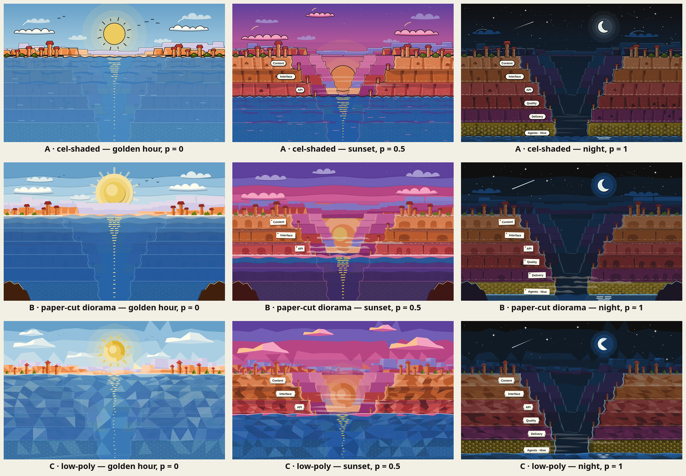

# Canyon art direction, round 1

Issue: #1051 (design round 1 of the canyon in the Agentic tab, epic #1048). Spec:
[`docs/superpowers/specs/2026-11-02-agentic-canyon-animation-design.md`](../../../superpowers/specs/2026-11-02-agentic-canyon-animation-design.md),
sections "The scene", "Colour", "Fidelity and design rounds" and "The layers (pillars)".

The storyboard (`../canyon-storyboard.svg`) fixed the composition and the story. Tim found its art "low on
polygons". This round draws the same scene in three richer art directions so Tim can pick one to develop in
round 2 (#1052).

| Direction | Golden hour (`p = 0`) | Sunset (`p = 0.5`) | Night (`p = 1`) |
| --- | --- | --- | --- |
| A · cel-shaded | [`cel-shaded-golden.svg`](cel-shaded-golden.svg) | [`cel-shaded-sunset.svg`](cel-shaded-sunset.svg) | [`cel-shaded-night.svg`](cel-shaded-night.svg) |
| B · paper-cut diorama | [`paper-cut-golden.svg`](paper-cut-golden.svg) | [`paper-cut-sunset.svg`](paper-cut-sunset.svg) | [`paper-cut-night.svg`](paper-cut-night.svg) |
| C · low-poly | [`low-poly-golden.svg`](low-poly-golden.svg) | [`low-poly-sunset.svg`](low-poly-sunset.svg) | [`low-poly-night.svg`](low-poly-night.svg) |

## What every frame shares

All three directions use the same layout, so the comparison is about the art and not the composition.

- **Canvas:** `viewBox="0 0 1440 900"` (desktop). Phone framing is round 2.
- **Geometry:** the rim sits at `y = 340`. The six strata are equal bands of 86.7 px, from the rim down to the floor
  at `y = 860`. The gorge narrows one step per stratum, with a ledge at each step.
- **Waterline:** `y = 346 + 514 · p`. The reveal rule from the spec ("stratum `i` is revealed when
  `p ≥ (i + 0.5) / 6`") decides which tablets are drawn:
  - `p = 0` shows none. The water is brimming at the rim, and the submerged canyon shows through it.
  - `p = 0.5` shows Content, Interface and API.
  - `p = 1` shows all six.

  The storyboard showed Content above the water at `p = 0`, which the reveal rule does not allow. The frames
  follow the rule.
- **Depth:** five planes behind the near walls:
  - far mesas in haze;
  - a second mesa line;
  - mid buttes on both rims;
  - two receding inner gorges inside the V, with a river glint on each floor.
- **Rock:** each stratum has lit and shadowed faces, erosion notches, alcoves and talus at the cliff foot, and a
  rim-lit edge on the side facing the gorge.
  - Hoodoos stand on the rim and on every ledge.
  - The bedrock (Agents · Hive) is a honeycomb whose cells catch the light.
- **Light:**
  - Cast shadows under each ledge and behind each hoodoo get longer from golden hour to sunset, then go at night.
  - A purple tint at sunset and a blue-black tint at night darken the land, and moonlit edges replace the warm rim
    light.
- **Water:**
  - A broken reflection column under the sun or moon, and wave bands.
  - Foam along the walls at the waterline.
  - A dashed tide line on each revealed stratum, and a wet band just above the surface.
  - The edges of the drowned strata stay visible under the surface.
- **Atmosphere:** two cloud layers and birds at golden hour, mist in the gorge at sunset, and stars, a crescent
  moon, a meteor and a satellite at night.
- **Colour:** only Flexoki values (accent ramps 50–950 and base greys) plus ink `#100F0F` and paper `#FFFCF0`. A
  script checked every hex value in every frame against the Flexoki README tables.
- **Constraints:** no `filter`, no raster images, no external references, no scripts, no fonts beyond the site's
  `font-family` stack.

## A · cel-shaded cartoon

**Look.** Bold, saturated, comic-book. Every solid shape has the spec's 3 px ink outline. Rock faces are cut into
blocks, each with one hard shadow facet and one lit sliver. Clouds and hoodoos get a single outline around their
merged silhouette, drawn as a thick ink stroke under the fill. Tablets are paper pills with a hard drop shadow.

**Why.** This is closest to the spec's "cartoon style" paragraph (flat fills, 3 px ink outline, one highlight per
shape), so it needs no change to the spec. The outlines keep the strata readable at any size, and they match the
storyboard Tim liked, so it is the safe evolution.

**How it would animate with `--p`.**

- Sky: four gradient rects crossfade by opacity (golden, sunset, dusk, night).
- Sun: one group moves down with `translateY`. Yellow, orange and red discs crossfade, and the ray strokes fade
  out by `p ≈ 0.3`.
- Moon and stars: their groups fade in from `p ≈ 0.6`. Stars twinkle in three staggered groups.
- Parallax: far mesas, mid buttes and the two inner gorges each get their own small `translateY`. The near walls
  are the stage and do not move.
- Water: one group moves with `translateY(514px · p)`. Two water layers (day blue, night blue) crossfade, and the
  wave bands drift sideways as an ambient loop.
- Light: two pre-drawn cast-shadow paths (short and long) crossfade. The sunset and night tints and the moonlit
  edge strokes are opacity layers.
- Tablets: fade or slide in on `data-revealed`.

**Risks.**

- The 3 px outlines are fixed in user units, so on a phone the scaled-down SVG makes them thinner. Round 2 should
  check `vector-effect: non-scaling-stroke` or a phone-specific stroke width.
- Translucent water over red and orange rock goes muddy below about 85 % opacity, so the frames use 88–95 % with a
  line overlay of the drowned edges instead.

## B · paper-cut diorama

**Look.** A layered paper diorama.

- Every plane is a flat sheet with a hand-cut, slightly wobbly edge and its own offset shadow (a darker copy shifted
  a few pixels, no `filter`). There are no ink outlines; depth comes from the stacked shadows.
- The sky is stepped paper bands, not a smooth gradient. The sun is a stack of paper discs.
- Each stratum is its own strip with an overhanging lighter lip, arched alcoves and fissures cut into it.
- The honeycomb is cut tiles over a darker sheet.
- The water is translucent vellum strips. Tablets are pinned paper tags at slight angles.
- Dark outcrops in the bottom corners frame the scene as the nearest plane.

**Why.** It reads as crafted rather than drawn, and its many planes fit parallax: every sheet is already a
separate layer, so moving each one at its own rate is natural. It is the biggest departure from the rest of the
site while staying in the palette.

**How it would animate with `--p`.**

- Planes: each plane is a group (sheet plus its shadow) with its own `translateY` rate, about nine depth rates
  from far mesas to the foreground outcrops.
- Sky: three sets of stepped bands with identical edges crossfade by opacity, so only the colours change.
- Sun: the disc stack moves down as one group.
- Water: the vellum strips move down with the waterline, each with a slightly different rate so the strips
  separate as they fall.
- Light: shadows, tints and tablets work as in A.

**Risks.**

- It has no ink outline, so the spec's "cartoon style" paragraph would need amending in round 2.
- The duplicated shadow paths double the path data. Frames are about 230 KB raw (about 44 KB gzipped), the
  heaviest of the three.
- Crossfading stepped skies can show a ghosted band edge mid-fade if the edges differ, so the band edges must be
  shared across all four skies.
- The thin paper edge shadows may shimmer at fractional `translateY` values. Snap the parallax offsets to whole
  pixels if they do.

## C · stylised low-poly

**Look.** Everything is a mesh of flat triangles.

- Each stratum on each wall is a triangulated mesh. Every facet is shaded by a simple Lambert model from the sun
  or moon direction, and snapped to that stratum's four Flexoki tones (deep, shadow, base, lit).
- The sky is a coarse triangle grid snapped to the Flexoki ramp. The ridgelines, clouds, hoodoos and junipers
  are faceted.
- The sun is a cut gem. Each honeycomb cell is a six-facet raised prism.
- The water is a facet mesh with a column of diamond shards for the reflection. Tablets are bevelled plaques.
- There are no outlines; facets carry all the edges.

**Why.** It literally answers "more polygons": about 4,100–4,250 polygons per frame, against fewer than 100 drawn
shapes in the whole storyboard. The facet shading makes the light direction visible, so the change from sun to moon
reads on the rock itself and not only in the sky.

**How it would animate with `--p`.**

- Rock: because the shading depends on the light direction, each time of day needs its own pre-shaded wall mesh
  (golden, sunset, night). Those meshes crossfade by opacity. The cheaper alternative is one mesh with tint
  overlays, which loses the moving light.
- Sky: three faceted skies crossfade.
- Sun and moon: the gem sun moves down with `translateY`, and the moon fades in.
- Water: the water mesh moves down with the waterline, and an ambient loop drifts it sideways.
- Parallax: works as in A.

**Risks.**

- The look is the most "tech demo" of the three and the furthest from cartoon. It needs the spec's style
  paragraph rewritten.
- Path data is large (about 165 KB raw, about 39 KB gzipped per frame), and three pre-shaded wall meshes would
  roughly triple the wall share in production.
- Facets need a same-colour hairline stroke to hide anti-aliasing seams. Some renderers may still show faint seams
  on the sky triangles; round 3 should check on real browsers.

## Node budget

The spec's budget for the final scene is under ~1,500 SVG nodes. Counts are every element in the file, including
`<title>`, `<desc>`, `<defs>`, gradients and stops. Polygons are closed subpaths: shapes of one colour share a
`<path>`, so a frame can carry thousands of polygons in a few hundred nodes.

| Frame | Nodes | Polygons | Raw size | gzip -9 |
| --- | ---: | ---: | ---: | ---: |
| `cel-shaded-golden.svg` | 188 | 1,259 | 111 KB | 29 KB |
| `cel-shaded-sunset.svg` | 199 | 1,289 | 113 KB | 29 KB |
| `cel-shaded-night.svg` | 211 | 1,423 | 114 KB | 27 KB |
| `paper-cut-golden.svg` | 220 | 1,416 | 234 KB | 44 KB |
| `paper-cut-sunset.svg` | 237 | 1,394 | 238 KB | 45 KB |
| `paper-cut-night.svg` | 241 | 1,444 | 227 KB | 43 KB |
| `low-poly-golden.svg` | 122 | 4,237 | 169 KB | 39 KB |
| `low-poly-sunset.svg` | 138 | 4,123 | 168 KB | 38 KB |
| `low-poly-night.svg` | 147 | 4,095 | 169 KB | 39 KB |

For comparison, the storyboard SVG holds all three of its frames in 159 nodes and fewer than 100 drawn shapes.

The production scene is one SVG holding every time-of-day layer at once, crossfaded by opacity. Even the sum of a
direction's three frames stays under the budget: A 598, B 698, C 407 nodes. Round 3 measures the real count.
Separate groups for the parallax rates and the ambient loops will add some nodes, and merging the shared rock
geometry will remove more.

## What this round does not settle

- Phone framing, page chrome, the rim project flags and one hoodoo per pillar item are round 2 (#1052). Here
  hoodoos are scenery, one or two per ledge.
- Tablets sit on the left wall next to the gorge. The desktop text cards also live in a left column, so round 2
  must place the tablets where the cards do not cover them.
- Motion timing, easing and phone frame rate are round 3 (#1053).

## How the frames were made

A throwaway Python script (not committed) generated the SVGs from one shared scene model: wall profiles, strata,
waterline and reveal rule. Each direction had its own renderer. Each frame was rasterised with
`magick <svg> <png>` (librsvg) and checked by eye. The contact sheet was made with `magick montage` at 600×375 per
frame.
