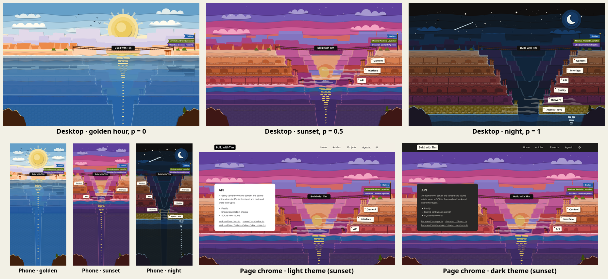

# Canyon art, round 2: paper-cut refinement

Issue: #1052 (design round 2 of the Agentic tab canyon, epic #1048). Spec:
[`docs/superpowers/specs/2026-11-02-agentic-canyon-animation-design.md`](../../../superpowers/specs/2026-11-02-agentic-canyon-animation-design.md),
"Fidelity and design rounds". Round 1 (`../round-1/`) offered three art directions, and Tim picked **B, paper-cut
diorama**. This round develops B into the final frames for Tim to sign off. Round 3 (#1053) builds the scroll
prototype from them.

| File | What it is |
| --- | --- |
| [`desktop-golden.svg`](desktop-golden.svg), [`desktop-sunset.svg`](desktop-sunset.svg), [`desktop-night.svg`](desktop-night.svg) | 1440×900 frames at `p = 0`, `0.5`, `1` |
| [`phone-golden.svg`](phone-golden.svg), [`phone-sunset.svg`](phone-sunset.svg), [`phone-night.svg`](phone-night.svg) | 390×844 portrait frames at the same `p` values |
| [`desktop-sunset-chrome-light.svg`](desktop-sunset-chrome-light.svg), [`desktop-sunset-chrome-dark.svg`](desktop-sunset-chrome-dark.svg) | The desktop sunset frame under the site top bar with the API card over it, in the light and dark themes |
| `contact-sheet.png` | All eight at a glance |

## What changed since round 1

- **Every stratum and pillar.** All six strata are in every frame, and each has one hoodoo per pillar item, 23
  in all. The counts come from `front-end/src/features/agentic/config/canyon-strata.ts`: Content 3, Interface 4,
  API 3, Quality 4, Delivery 5, Agents · Hive 4.
  - Each hoodoo is a `<g data-pillar="…">` carrying the pillar's text, so the scene can be generated from the
    config.
  - Hoodoos stand on the top of their own stratum, the ledge where the stratum above steps back. A stratum's
    hoodoos split across the two walls, left first. Content is the exception: its ledge sits in front of the rim
    cap, and on desktop all three stand on the right wall, because a left one would sit under the card column.
    On phone it is one left and two right.
- **The rim.**
  - A rope bridge spans the gorge at the rim, carrying the site name, "Build with Tim", on a sign drawn like the
    site's wordmark (ink plate, paper lettering).
  - One pennant per published project (the `content/` files with `type: project`) flies from a pole on the right
    rim: Dailies, Minimal Android Launcher and Obsidian Content Pipeline, newest first. Each pennant is a
    `<g data-project="<slug>">` and becomes a link to `/projects/<slug>` in production.
  - Paper text on the pennants (blue-600, green-700, purple-600) is 6.4:1, 6.0:1 and 7.6:1. I moved
    green-600 to green-700 because green-600 only reaches 4.4:1.
- **Reflections.**
  - The sun's reflection is a broken column of paper slips.
  - At night the moon's column sits under the moon.
  - At golden hour the calm water also mirrors the rim skyline: ridges, bridge, sign, flags and junipers, cut into
    ripple bands.
- **Paper detail.**
  - Each stratum strip has an overhanging lighter lip with a smooth scalloped edge (round 1's lips were zig-zag),
    plus a darker bedding strip near its foot, arched alcoves and fissures.
  - The honeycomb bedrock is cut tiles with a lit corner.
  - The foreground outcrops now have a lit edge and a juniper.
- **Readable labels at night.** The site name and flags sit above the sunset and night tints, so they stay
  readable.

## The golden-hour fix: a rim cap above stratum 1

In round 1, golden hour was mostly water. The reveal rule (`p ≥ (i + 0.5) / 6`) and the waterline mapping keep the
water at the top of stratum 1 at `p = 0`, so stratum 1 has to start under water.

**Decision:** the rim is a separate **rim cap**, a pale caprock band (orange-150 with an orange-200 layer) above
stratum 1, that is never part of the reveal.

- At `p = 0` the water sits exactly at the cap's foot, the top of stratum 1. That is "just below the rim lip".
- The cap's top carries the bridge, the site name, the flags and the junipers. They are visible from the first
  frame, so golden hour opens on land, not on a lake.
- Content's three hoodoos stand on the ledge in front of the cap, so they are also visible at `p = 0` and get
  their feet wet.
- Waterline: `y = R + 6 · BH · p`, where `R` is the top of stratum 1 and `BH` is the band height. The reveal rule
  is unchanged, and stratum 1 becomes visible at `p = 1/12`.

The golden water no longer reads as empty:

- Lighter vellum strips near the surface (blue-150 → blue-600 with depth).
- The mirrored rim skyline.
- The drowned strata edges.
- The sun column.

The cap costs 40 px on desktop (26 px on phone) of what used to be stratum height. The six bands are now 72 px
(desktop) and 46 px (phone).

## Layout

| | Desktop 1440×900 | Phone 390×844 |
| --- | --- | --- |
| Gorge axis `CX` | 880, right of centre (spec "Responsive") | 195, centred |
| Rim cap top / stratum 1 top `R` | 344 / 384 | 224 / 250 |
| Band height `BH`, floor | 72, 816 | 46, 526 |
| Gorge half-width per stratum (top) | 300, 250, 204, 160, 118, 80 | 118, 98, 79, 60, 41, 24 |
| Sun at golden / sunset (x, y, r) | 880, 190, 64 / 880, 522, 74 | 195, 104, 38 / 195, 330, 44 (≈ 60 % of desktop) |
| Moon (x, y, r) | 1196, 118, 34 | 312, 80, 22 |
| Text cards | Left column `max-w-md`: x 112–560 (container 80 + `lg:px-8`) | Bottom third, y > 563 |
| Tablets | All on the right wall, 28 px from the gorge edge | Alternate left and right walls, 7 px from the edge |

On desktop nothing that carries meaning sits under the card column:

- Tablets span x 984–1312 (Agents · Hive is the leftmost).
- Hoodoos span x 592–1235.
- The flags span x 1202–1403.

Only the left wall's plain rock and the bridge's left anchor sit under the cards. On phone the strata, tablets,
rim and flags all fit above y = 563. The bottom third is the lake (and, at night, the drowned floor), which the
cards cover.

## Layers, parallax and the `--p` map

Each frame groups its layers with the ids below, so round 3 can lift them into the prototype. Parallax is a
`translateY` that grows linearly with `p`. The values are pixels at `p = 1` on desktop. Phone uses 0.6× (the
frames apply this). The near walls are the stage and do not move, so the tablets, waterline and reveal rule stay
aligned.

| Layer id (back → front) | Parallax at `p = 1` | Other per-frame change (opacity unless noted) |
| --- | ---: | --- |
| `sky` (variants `sky-golden`, `sky-sunset`, `sky-dusk`, `sky-night`) | 0 | Crossfade: golden 1 → 0 over 0–0.45. Sunset 0 → 1 over 0–0.45, then → 0 by 0.75. Dusk 0 → 1 over 0.45–0.75, then → 0 by 1. Night 0 → 1 over 0.75–1. The stepped bands share their edges, so only colour changes |
| `stars` (three `data-twinkle` groups) | +40 | 0 → 1 over 0.6–0.9. Ambient twinkle, staggered |
| `moon` | 0 | 0 → 1 over 0.8–1 |
| `clouds-back` | +34 | Golden, sunset and night colour variants crossfade with the sky weights |
| `sun` (variants `sun-golden`, `sun-sunset`, plus a red disc) | (own path) | `translateY`: desktop 190 → 522 at 0.5, about 664 px per unit of `p`. It goes behind the far gorge floor by `p ≈ 0.7`. Discs crossfade yellow → orange → red. Rays 1 → 0 over 0–0.3. Glow `scale` 1 → 0.8 |
| `ridge-far`, `ridge-far-2`, `ridge-far-3` | +36, +26, +20 | Three colour variants each, crossfaded with the sky weights |
| `clouds-front` | +26 | As `clouds-back` |
| `buttes` | +14 | Three colour variants |
| `gorge-far`, `gorge-near` | +10, +5 | Three colour variants. The river glints never change |
| `walls` (rim cap and six strata) | 0 | Static. Colour comes from the tints below |
| `shadows-short`, `shadows-long` (ledge and hoodoo cast shadows) | 0 | Short 1 → 0 over 0–0.4. Long 0 → 1 over 0.1–0.5, then → 0 by 0.85. None at night |
| `hoodoos` (23 `data-pillar` groups) | 0 | Static |
| `rim` (bridge, pole, junipers) | 0 | Static |
| `tint-sunset`, `tint-night`, `moonlit-edges` | 0 | Sunset tint 0 → 0.14 at 0.5 → 0 by 0.8. Night tint 0 → 0.5 over 0.55–1. Moonlit edges 0 → 0.45 over 0.7–1 |
| `rim-labels` (site sign, `data-project` pennants) | 0 | Static, above the tints |
| tide lines | 0 | Per stratum, shown on `data-revealed` |
| `mist` | 0 | 0 → 0.4 at 0.5 → 0.25 at 1. Ambient sideways drift |
| `water` (variants `water-golden`, `water-sunset`, `water-night`) | `translateY` 432 (phone 276) = `6 · BH · p` | Colour variants crossfade with the sky weights. `sun-column` follows the sun's visibility (1 → 0 by 0.7). `moon-column` 0 → 1 over 0.8–1. `rim-reflection` 0.5 → 0 by 0.3, with its own extra `translateY` of `6 · BH · p` because a mirror image moves twice as fast as its axis. Foam rides with the group. Ambient: the strips drift sideways |
| drowned strata edges | 0 | Fallback plan below |
| `foreground` | −14 | Static colour, re-tinted with the land |
| `tablets` (`data-tablet`) | 0 | On `data-revealed`: opacity 0 → 1 and `translateX` 12 px → 0 |
| `birds` | 0 | 1 → 0 over 0–0.3. Ambient flight drift |

Two things for round 3 to check:

- **Drowned edges.** The frames clip the drowned strata edges to below the waterline with a `clipPath`. Moving
  that clip per frame may not be compositor-only. The fallback is to split the edges per stratum and fade each
  stratum's segment out on its `data-revealed`, which needs no clip.
- **Path size.** The hand-cut edges come from subdivided, jittered polygons. A desktop frame is about 340 KB raw,
  about 62 KB gzipped. Round 3 should measure parse time on a phone and coarsen the cut step if it shows up.

## Node budget

Spec budget: under ~1,500 SVG nodes. Counts are every element in the file (`title`, `desc`, groups, clip paths,
paths, text). Polygons are closed subpaths.

| Frame | Nodes | Polygons | Raw | gzip -9 |
| --- | ---: | ---: | ---: | ---: |
| `desktop-golden.svg` | 408 | 2,295 | 344 KB | 64 KB |
| `desktop-sunset.svg` | 421 | 2,146 | 338 KB | 62 KB |
| `desktop-night.svg` | 424 | 2,200 | 332 KB | 61 KB |
| `phone-golden.svg` | 401 | 2,637 | 243 KB | 44 KB |
| `phone-sunset.svg` | 414 | 2,520 | 240 KB | 43 KB |
| `phone-night.svg` | 421 | 2,536 | 242 KB | 43 KB |
| `desktop-sunset-chrome-light.svg` | 456 | 2,164 | 345 KB | 64 KB |
| `desktop-sunset-chrome-dark.svg` | 455 | 2,165 | 345 KB | 64 KB |

**Production estimate.** The production scene holds all the layers at once.

- Counting the shared layers once and every per-time layer in each frame gives 554 nodes on desktop and 551 on
  phone.
- Each frame is mostly the shared layers: walls 141, hoodoos 116, tablets 31 at night, rim 12, rim labels 17.
- Adding the other two colour variants of the ridges, buttes and inner gorges, plus a dusk sky, gives about 670.
- That is well under 1,500.

## Page chrome

The chrome frames put the desktop sunset frame under the site's top bar (`h-[4.2rem]`, `--site-page-bg`, the
wordmark from `front-end/src/shared/components/site-logo.tsx`, nav with Agentic active, theme toggle). The API
stratum card sits in the left column (`rounded-xl border bg-card p-8`, heading, sentence, pillars, mono source
links).

Chrome colours are the theme tokens from `front-end/src/index.css`:

- **Light:** page `#f3efe5`, card `#ffffff`, text `rgb(0 0 6 / 80%)`, border `rgb(0 0 6 / 7%)`, active underline
  `--ink-4`.
- **Dark:** page `#1c1b1a`, card `#282726`, text `#cecdc3`, border `#403e3c`, underline `--paper-4`.

The scene itself is identical in both themes.

## Checks I ran

- I rendered every SVG with `magick <svg> <png>` (librsvg) and looked at each PNG, iterating until it read
  cleanly.
- A script checked each file:
  - every hex colour in the six scene frames is a Flexoki value (accent ramps, base greys, ink `#100F0F`, paper
    `#FFFCF0`); the chrome frames add only the theme tokens listed above;
  - no `<filter>`, `<image>`, `<script>`, `xlink` or external URL;
  - node counts as in the table.

## How the frames were made

A throwaway Python generator (not committed) builds the frames from one scene model: layout, wall profiles,
strata, pillar list, waterline and reveal rule. It extends the round-1 direction-B renderer.
