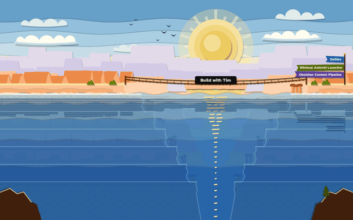
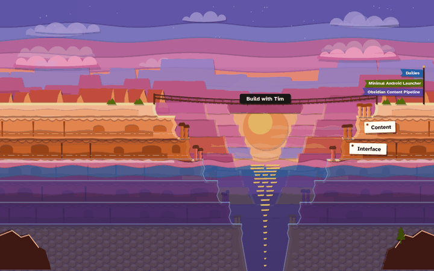
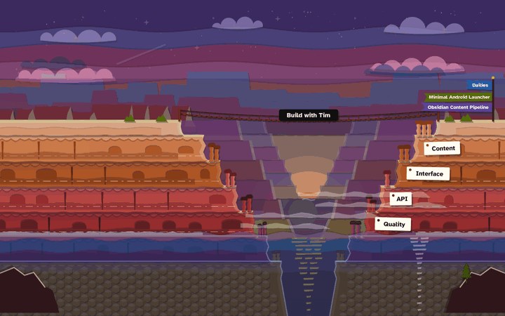
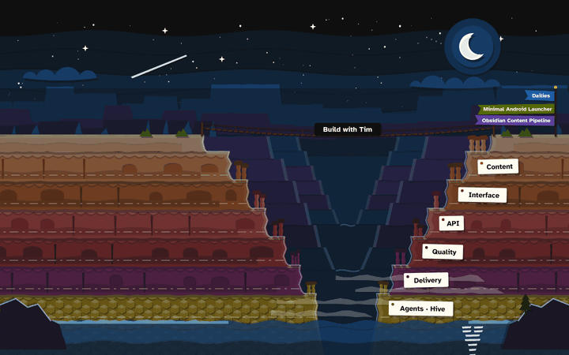

# Canyon motion study, round 3

Issue: #1053, design round 3 of the Agentic tab canyon (epic #1048). Spec:
[`docs/superpowers/specs/2026-11-02-agentic-canyon-animation-design.md`](../../../superpowers/specs/2026-11-02-agentic-canyon-animation-design.md),
sections "Fidelity and design rounds" and "Scroll mechanics". The art is the round-2 paper-cut frames
(`../round-2/`).

[`prototype.html`](prototype.html) is a throwaway, self-contained scroll prototype. It has inline SVG, CSS and
a short script, and no external references. Open it in a browser and scroll.

- Desktop art is shown above 640 px; phone art below 640 px, switched by a media query.
- `?clip=inset` switches the drowned strata to the clip-path method (see "Clipping the drowned strata").
- `?hud` shows `p` and the reveal count.

| `p = 0` | `p = 0.35` | `p = 0.65` | `p = 1` |
| --- | --- | --- | --- |
|  |  |  |  |

Phone at `p = 0.65`: [`still-phone-p065.png`](still-phone-p065.png).

## Mechanics in the prototype

- **Track.** A `<section>` of `100svh + 6 × 70svh` (`60svh` per stratum on phone). It holds a `position: sticky`
  scene of `100svh` and the six stratum cards as ordinary blocks that scroll past it.
- **One listener, one rAF.** One passive `scroll` listener queues at most one `requestAnimationFrame` per frame. The
  rAF computes `p = clamp(−trackTop / (trackHeight − viewportHeight), 0, 1)` and writes `--p`.
- **Reveal rule.** Stratum `i` is revealed when `p ≥ (i + 0.5) / 6`. `data-revealed` is toggled only when the count
  changes, and the tablets fade in on it.
- **Moving parts.** Everything that moves is a `transform: translate3d(0, calc(var(--p) × rate × u), 0)` or an
  `opacity: calc(…var(--p)…)` crossfade, where `u` is the art's scale factor for the viewport.
- **Ambient loops.** The water drift, sun glow and star twinkle run only under
  `prefers-reduced-motion: no-preference`. An IntersectionObserver on the track sets `animation-play-state: paused`
  when the scene is off-screen.
- **Reduced motion.** There is no listener and no sticky scene. The track collapses to its content, and the scene
  is a static `p = 0.5` frame with all six tablets visible, followed by the cards. I checked this under
  `prefers-reduced-motion: reduce`: `position: relative`, `--p` 0.5, no animations, 6 of 6 tablets at opacity 1.

## How the scene must be built (the main finding)

I compared four ways to build the same art. All measured on a throttled phone and desktop (setup below).

1. **One inline SVG, CSS transforms and opacity on `<g>` layers** (the obvious port of the round-2 frames). Chrome
   does not composite individual SVG children. Every scroll frame ran **Layout and Paint**, and the whole SVG was
   re-rastered.
2. **One HTML box per layer** (`
<svg viewBox=…>`, absolutely positioned) with `will-change`, every
   box the size of the viewport. No layout or paint per frame, but 60 full-screen composited layers. That is too much
   compositing and texture memory.
3. **Option 2, with each box cropped to the rows (and, where possible, columns) its art uses.** The SVG `viewBox`
   is cropped to match, with `preserveAspectRatio="none"` and `overflow: hidden`. Planes that move together are also
   merged.
4. **Option 3, with `--p` not inherited into the SVGs.** `@property --p, --ty, --op { inherits: false }`, and the rAF
   writes `--p` on every driven layer box instead of the track. In options 1–3 every custom-property change
   restyled every SVG element under the track.

Option 4 is what `prototype.html` ships. The other three were measurement-only variants, not committed.

### Results

Each run scrolls the whole track at constant speed over 5 s, driven by rAF. A long frame is longer than 25 ms.
"Draw" is the compositor's `DirectRenderer::DrawFrame` time per frame. Texture memory is an upper bound: drawn layer
area × DPR² × 4 bytes, from the CDP layer tree, scene layers only.

**Phone: 390×844, DPR 3, CPU throttled 4×**

| Variant | fps | p95 frame | Long frames | Layout / Paint events (5 s) | Style recalc per frame | Draw per frame | Scene layers, texture memory |
| --- | ---: | ---: | ---: | --- | ---: | ---: | --- |
| 2. full-viewport layers | 59.0 | 16.8 ms | 3 (max 66 ms) | 0 / 201 | 6.1 ms | 7.3 ms | 60, ≈ 667 MB |
| 3. cropped, `--p` inherited | 57.4 | 16.8 ms | 4 (max 183 ms) | 0 / 34 | 7.1 ms | 3.8 ms | ≈ 201 MB |
| **4. cropped, `--p` per layer (shipped)** | **60.0** | **16.8 ms** | **0 (max 16.8 ms)** | **0 / 33** | **2.2 ms** | **3.5 ms** | **61, ≈ 170 MB** |

**Desktop: 1440×900, DPR 1, CPU throttled 4×**

| Variant | fps | p95 frame | Long frames | Layout / Paint events (5 s) | Style recalc per frame | Draw per frame | Scene layers, texture memory |
| --- | ---: | ---: | ---: | --- | ---: | ---: | --- |
| 1. one SVG, transforms on `<g>` | 53.4 | 33.3 ms | 31 (max 67 ms) | **266 / 534**, raster 3.5 s | 4.1 ms | 14.4 ms | 1 |
| 2. full-viewport layers | 43.2 | 33.4 ms | 66 (max 183 ms) | 0 / 236 | 6.1 ms | 20.7 ms | 60, ≈ 292 MB |
| **4. cropped, `--p` per layer (shipped)** | **60.0** | **16.7 ms** | **0 (max 16.8 ms)** | **0 / 61** | **2.2 ms** | **11.4 ms** | **61, ≈ 74 MB** |

In the shipped build no Layout runs during scrolling. The remaining Paint events are not per frame: 33 on phone in a
300-frame run, 3 ms in total. With the scene hidden the same run paints 4 times, so about 29 come from the scene.
They are most likely the reveal toggles: 18 `data-revealed` flips (tablet, tide line and drowned edges for six
strata), each of which invalidates one small layer once. The other per-frame main-thread work is the style recalc
of the layer boxes, 2.2 ms at 4× throttling.

**First render on the phone profile (4× CPU):**

- HTML parse 37–40 ms, first style 22 ms, layout 4 ms, paint 6 ms, raster 22 ms.
- `DOMContentLoaded` at about 120 ms and first contentful paint at about 140 ms, served from localhost.
- `prototype.html` is 1.06 MB (160 KB gzipped) because it carries both the desktop and phone art. Each art set is
  about 785 elements in 61 layer boxes, under the spec's ~1,500-node budget. Production should render only the art
  for the current breakpoint.

### Measurement setup and limits

- Headless Chromium 150 driven through CDP (Puppeteer), with WebGL on ANGLE / SwiftShader. That is a software GPU,
  so "Draw" times are pessimistic in absolute terms and only meaningful relative to each other.
- `Emulation.setCPUThrottlingRate` 4×. The phone profile is `390×844 @3x`, mobile and touch. Traces use
  `devtools.timeline`, `viz` and `cc`. Layers come from the CDP `LayerTree` domain.
- No real phone was available, so the spec's "manual performance trace on a mid-range phone" still has to happen
  on a device in T5 (#1056). Check texture memory first (below).

## Clipping the drowned strata

Both methods are in the prototype.

| Method | Phone paints (5 s) | Phone paint time | Desktop paints | fps |
| --- | ---: | ---: | ---: | ---: |
| `clip-path: inset(top = waterline)` on one drowned-edges layer (`?clip=inset`) | 2,290 | 204 ms | 2,464 | 60 (phone), 60 (desktop) |
| **Per-stratum layers that fade out on `data-revealed` (600 ms ease-out, default)** | **33** | **3 ms** | **61** | **60, 60** |

**Chosen: per-stratum fade.** Moving a clip edge is not compositor-only: Chrome repaints the clipped layer about 8
times a frame. It holds 60 fps here only because the layer is cheap. The fade differs from a hard clip in one way:
a stratum's drowned edges stay drawn until the waterline passes the middle of its band. That is the same moment its
tablet appears, so it reads as one event.

## Layers, rates and timing

Rates are `translateY` at `p = 1` in art units. Phone uses 0.6× for parallax and its own band height for the water.
All `p` curves are linear in `p`, because the scroll position already acts as the easing. Easing curves are only used
for the time-based reveal fades and ambient loops.

| Layer (prototype `data-layer`) | Motion | Opacity curve |
| --- | --- | --- |
| `sky-golden / -sunset / -night` | none | Step crossfade: sunset `clamp(p/0.45)` over golden, golden drops to 0 at 0.45; night `clamp((p−0.5)/0.35)` over sunset, sunset drops to 0 at 0.85. At most two variants are drawn. The spec's dusk sky is the sunset-to-night overlap (0.5–0.85), with no separate layer |
| `stars-1/2/3` | +40 | `clamp((p−0.6)/0.3)`. Ambient twinkle 1 ↔ 0.45, ease-in-out alternate, 3 s / 3.8 s / 4.6 s with negative delays |
| `moon` | none | `clamp((p−0.8)/0.2)` |
| `clouds-back-*` | +34 | Symmetric crossfade: golden `1 − S`, sunset `S − N`, night `N` |
| `sun-golden`, `sun-sunset` (+ `sun-glow-*`) | `translateY(2·(y_sunset − y_golden)·p)`, desktop 664·p; the sunset disc is offset −332 so the two travel as one sun | Golden `1 − S`. Sunset `S`, fading out over 0.62–0.78 as the sun sinks behind the far gorge floor. Glow breathes 0.7 ↔ 1 over 4 s, ease-in-out |
| `ridges-*` (round-2 ridge-far, -far-2, -far-3 merged) | +28 | Step crossfade, as the sky |
| `clouds-front-*` | +26 | Symmetric |
| `buttes-*` | +14 | Step |
| `gorges-*` (gorge-far and gorge-near merged) | +8 | Step |
| `walls`, `stage` (hoodoos and rim), `rim-labels` | none | Static |
| `shadows-short`, `shadows-long` | none | Short 1 → 0 over 0–0.4. Long `min((p−0.1)/0.4, (0.85−p)/0.35)` |
| `tint-sunset` | none | 0.14 × `min((p−0.2)/0.3, (0.8−p)/0.3)` |
| `tint-night` (night tint and moonlit edges in one layer) | none | `clamp((p−0.55)/0.45)`. The tint is 0.5 and the edges 0.45 inside the layer |
| `tide-0…5` (below the water) | none | 0 → 1 over 500 ms ease-out on `data-revealed` |
| `mist-sunset`, `mist-night` | +6·BH (with the water) | Sunset `min((p−0.3)/0.2, (0.8−p)/0.2)`. Night `clamp((p−0.6)/0.25)` |
| `water-golden / -sunset / -night` | +6·BH (432 desktop, 276 phone) | Symmetric. Ambient drift ±8u over 6 s, ease-in-out alternate (the drifting SVG is 16u wider) |
| `rim-reflection` | +12·BH (a mirror moves twice as fast as its axis) | 1 → 0 over 0–0.3 |
| `drowned-0…5` | none | 1 → 0 over 600 ms ease-out on `data-revealed` |
| `tablet-0…5` (above the water) | none | 0 → 1 over 500 ms ease-out on `data-revealed`. Opacity only: a CSS transform would replace each tag's `rotate()` |
| `foreground-*` | −14 | Step |
| `birds` | none | 1 → 0 over 0–0.3 |

`S = clamp(0, p/0.45, 1)` and `N = clamp(0, (p−0.5)/0.35, 1)`. Nothing loops faster than once every 2 s, and
nothing flashes.

## Art changes needed to hold 60 fps

None of the drawing changes. The structural changes against the round-2 README are these:

- **Ridges:** the three far ridgelines move as one plane (+28 instead of +36, +26 and +20).
- **Gorges:** the two inner gorges move as one plane (+8 instead of +10 and +5).
- **Merged static layers:** the hoodoos and the rim are one static layer, and the night tint and moonlit edges
  are one layer.
- **Reveal layers:** each stratum's tablet, tide line and drowned edges are their own small layers.

Over the whole scroll the three ridgeline rates differed by at most 16 px. Merging them saved 6 layers.

**Optional, if a real phone shows memory pressure or checkerboarding:** about 170 MB of layer textures at DPR 3 is
the remaining risk. These would each remove a full-width layer variant (estimates at 390×844 @3x):

- Drop the sunset tint: −9 MB. Its 0.14 purple is subtle.
- Use two water variants (day → night) instead of three: −9 MB.
- Use two gorge variants and let the night tint darken the sunset one: −7 MB.
- Draw the three star groups in one layer that twinkles as a whole: −6 MB.

These are art changes, so Tim would decide them after the device trace.

## For T4 / T5 (#1055, #1056)

- Build the scene as stacked layer boxes, one `<svg>` per layer, cropped to its rows. Do not use CSS transforms on
  `<g>` elements inside one SVG. PR #1090 (#1055) currently uses one SVG per composition with `<g>` layers and an
  inherited `--p`, which is variant 1 above.
- Register `--p` (and any derived custom properties) with `@property … { inherits: false }` and write it on the
  driven layer boxes.
- Hide the drowned strata with per-stratum fades, not a moving clip.
- Render only the current breakpoint's art, which halves parse time and memory.
- The hook's thresholds and `revealedStrata` are unchanged: `(i + 0.5) / 6`.
- How these layers were generated: a throwaway script, `/tmp/canyon/r3proto.py` with `r3template.html`, building
  on the round-2 generator `r2.py`. Not committed.
