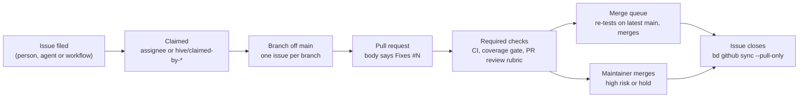

# Multi-agent orchestration

Several agents change this repository at the same time: Hive's agents, Claude
Code in CI, coding agents a maintainer runs locally, and Dependabot. None of
them talks to the others directly. GitHub is the shared coordination layer:
an issue is the unit of work, labels and assignees say who holds it, and a pull
request is the only way into `main`. This page is the contract every agent
follows so their work does not collide. `AGENTS.md` holds the full agent
ruleset; [`docs/security/SECURITY-AI.md`](security/SECURITY-AI.md) covers trust
boundaries and review, and [`docs/ai-ops-runbook.md`](ai-ops-runbook.md) how to
monitor agent work and debug it when it gets stuck.

## Agents

| Agent | Started by | Branches | Instructions |
| --- | --- | --- | --- |
| Hive agents (`app/hive-forge-app`), e.g. scanner, architect, quality, craftsman, strategist | Hive's own scheduler, outside this repo | `<type>/…` or `<agent>/…`, e.g. `fix/948-…`, `craftsman/…`, `quality/…` | `AGENTS.md` |
| Claude Code in CI (`.github/workflows/claude.yml`) | The `ai-fix-requested` label, or an `@claude` mention from an `OWNER`/`MEMBER`/`COLLABORATOR` | `claude/*` | `CLAUDE.md`, then `AGENTS.md` |
| Local coding agents (Claude Code, Cursor, Copilot, …) | A maintainer, one session per issue | `<type>/<number>-<slug>` | `AGENTS.md`, plus `CLAUDE.md`, `.cursor/rules/agent-guidance.mdc` or `.github/copilot-instructions.md`; the `github-issue-flow` skill in `.claude/skills/` |
| Dependabot (`.github/dependabot.yml`) | Weekly schedule | `dependabot/*` | — |

Workflows file work too: `.github/workflows/auto-issues.yml` opens (or comments
on) **Nightly compliance failing** when the nightly run fails on `main`, and
Hive files issues labelled `agent/<name>` for what its agents find. Those
issues enter the same loop as any other.

## The hand-off loop

1. **Issue first.** Every change starts from a GitHub issue. Work an agent
   finds but does not do becomes a new issue (`gh issue create`), not an
   unrelated change in the current PR. How each change links back to its issue
   is in [`agent-tasks/`](agent-tasks/README.md).
2. **Claim before working.** A local or CI agent assigns the issue
   (`gh issue edit <number> --add-assignee @me`); Hive adds
   `hive/claimed-by-<agent>`. Before starting, check the issue's assignees and
   labels and `gh pr list --search "<number>"`; skip an issue someone else holds
   or an open PR already covers (`stage/040-covered-by-pr`, `🐝 covered by PR`).
3. **One issue, one branch, one PR.** Pick work with `bd ready` or
   `gh issue list`; a child or follow-up issue waits until its parent lands,
   whatever its number.
4. **Same gates for every author.** CI, the coverage gate, the PR review
   rubric and the risk tier ([`risk-tiers.md`](risk-tiers.md)) run on every
   PR, whoever opened it.
5. **The merge queue merges.** `main` is protected; the
   [merge queue](#merge-queue) merges a PR once its required checks pass. The
   maintainer merges high-risk PRs and any PR labelled `hold`. Agents never
   run `gh pr merge` themselves.

## Merge queue

GitHub's own merge queue needs an organization-owned repository, so
`.github/workflows/merge-queue.yml` runs one on Actions. Whenever CI, the
coverage gate or the PR review rubric succeeds, a draft is marked ready, or
`hold` comes off a PR, it takes the oldest open PR that:

- comes from this repository, not a fork, and is not a draft;
- has no `hold` label;
- passes every required check (merge state `CLEAN`, so review threads are
  resolved too);
- is not high risk ([`risk-tiers.md`](risk-tiers.md)), rated from `main`'s
  `scripts/tier-classify.sh`.

It merges that PR onto the current `main` and runs lint, typecheck, unit tests
and build on the result; E2E and the prod-assets check are not re-run there.
If they pass and neither the PR nor `main` moved, it merges the PR (a merge
commit) and starts CI, the coverage gate and the quality report on `main` (a
merge made with `GITHUB_TOKEN` starts no push run, so the release job would
otherwise not run). If they fail, the PR gets `hold` and a comment linking the
run; fix it and remove `hold` to queue it again. Each run starts the next, so
the queue merges one PR at a time.

To keep a PR out of the queue, add `hold` or leave it a draft. Dependabot's PRs
change dependency or workflow files, which are high risk, so the maintainer
merges them. To drain the queue by hand: `gh workflow run merge-queue.yml`. The
logic lives in `scripts/merge-queue.sh`.

## Labels that carry state

| Label | Set by | Meaning |
| --- | --- | --- |
| `ai-fix-requested` | A triager, or Hive on issues it files | Hand the issue to Claude Code in CI |
| `agent/<name>` | Hive | The Hive agent that filed the issue |
| `hive/claimed-by-<agent>` | Hive | That Hive agent holds the issue |
| `stage/<NNN>-<name>` | Hive | Where the issue or PR is in Hive's pipeline, from `stage/010-actionable` to `stage/100-merge-queue`; the label descriptions on GitHub define each stage |
| `hold` | Hive, the merge queue, or a person | Keeps the PR out of the merge queue until removed: Hive sets it on its PRs, the queue on a PR that failed on the latest `main` |
| `acmm` | Hive | A gap found by Hive's ACMM evaluation |

## Beads

`bd` mirrors GitHub issue state into a local ledger so an agent can see ready
work and dependencies offline. GitHub stays the source of truth: claim and
close issues there, then run `bd github sync --pull-only`. Hive keeps its own
ledgers outside this repository.
