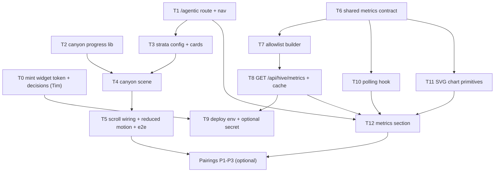

# Agentic Tab Implementation Plan

> **For agentic workers:** REQUIRED SUB-SKILL: Use superpowers:subagent-driven-development (recommended) or superpowers:executing-plans to implement this plan task-by-task. Steps use checkbox (`- [ ]`) syntax for tracking.

**Goal:** Add a top-level **Agentic** tab (`/agentic`) with two independent sections: a scroll-driven cartoon canyon
that reveals the pillars holding up the site, and a live, auto-refreshing panel of Hive metrics.

**Architecture:** One new front-end feature folder (`front-end/src/features/agentic/`). The canyon is inline SVG plus
CSS driven by a single `--p` custom property that a scroll hook writes. For the metrics, the back-end fetches Hive's
read-only widget summary (with the widget token) and its anonymous contributor endpoints. It caches them in memory
and serves an allowlisted summary at `GET /api/hive/metrics`. The front-end polls that every 60 s and draws its own SVG
charts. No owner token, no sidecar, no network change (research Q6).

**Tech Stack:** Bun workspace, React 19, react-router, Tailwind CSS v4, Fastify, `bun:test` with
`renderToStaticMarkup`, Playwright e2e, rootless `podman kube play`.

**Specs:**
- Canyon: [`docs/superpowers/specs/2026-11-02-agentic-canyon-animation-design.md`](../specs/2026-11-02-agentic-canyon-animation-design.md)
- Metrics: [`docs/superpowers/specs/2026-11-02-agentic-hive-metrics-design.md`](../specs/2026-11-02-agentic-hive-metrics-design.md)
- Pairings (optional): [`docs/superpowers/specs/2026-11-02-agentic-tab-pairings.md`](../specs/2026-11-02-agentic-tab-pairings.md)
- Research: [`research/hive_metrics_api.md`](../../../research/hive_metrics_api.md)

## Global Constraints

- No new dependencies (no chart, animation or validation library).
- TDD per `AGENTS.md`: one failing test, confirm it fails for the right reason, implement, run the full suite.
  Behaviour, not class strings.
- Quality gates after every task: `bun run test`, `bun run typecheck`, `bun run lint`, `bun run build`. E2E via
  `scripts/e2e.sh` on a podman host.
- One task = one GitHub issue = one branch `<type>/<number>-<slug>` = one PR with `Fixes #<number>`.
- Never publish a Hive field outside the allowlist in the metrics spec ("Public contract").
- Check light and dark mode for every surface that is not the canyon scene; WCAG 2.2 AA (`BRANDING.md` §6).
- Tasks touching `deploy/**` are high risk (`docs/risk-tiers.md`): the maintainer merges them.

## Order



The canyon track (T2-T5) and the metrics track (T6-T12) are independent after T1 and can run in parallel.

---

### T0: Mint the widget token and settle decisions (Tim, no code)

Already done: the server facts (research Q6, checked 2026-11-02). Hive's auth is on, the gateway listens on `*:3001`,
and the production pod reaches `host.containers.internal:3001`.

- [ ] **Step 1:** Mint the widget token in Hive (`POST /api/widget/token` or the dashboard) and create the podman
  secret on the host. The runbook for the secret comes in T9. The token is never in the repo.
- [ ] **Step 2:** Decide metrics spec Open decisions 2 (PR throughput source) and 3 (optional anonymous extras). The
  rest of this plan assumes the defaults: no throughput, no extras.

**Acceptance:** the issue records that the secret exists (not its value) and the two decisions.

---

### T1: `/agentic` route, nav tab and server route lists

**Files:**
- Modify: `shared/src/index.ts` (add `AGENTIC_PAGE_PATH = "/agentic"`)
- Modify: `front-end/src/App.tsx` (route), `front-end/src/shared/components/top-bar.tsx` (`navLinks`: Agentic after Projects)
- Modify: `front-end/server/handler.ts` (`APP_ROUTE` accepts the path), `front-end/server/seo.ts` (`STATIC_PAGE_PATHS`, `llms.txt` list)
- Create: `front-end/src/features/agentic/pages/agentic-page.tsx` (shell: `<main id={MAIN_CONTENT_ID}>` with an `h1`)
- Tests: `test/front-end/src/App.test.tsx`, the top-bar test under `test/front-end/src/shared/components/`, `test/front-end/server/handler.test.ts`, `test/front-end/server/seo.test.ts`

- [ ] **Step 1:** Failing test: `/agentic` renders the Agentic page heading (route table test in `App.test.tsx`).
- [ ] **Step 2:** Add the constant, route and page shell. Pass.
- [ ] **Step 3:** Failing test: the top bar lists Agentic and marks it active on `/agentic` and `/agentic#x`, desktop
  and mobile sheet. Implement. Pass.
- [ ] **Step 4:** Failing test: the production handler answers `/agentic` and `/agentic/` with the SPA (not the
  not-found meta). Implement via `APP_ROUTE`. Pass.
- [ ] **Step 5:** Failing test: sitemap and `llms.txt` include `/agentic`. Implement. Pass.
- [ ] **Step 6:** Full suite, gates, commit `feat(agentic): add the Agentic tab route (#<n>)`.

**Acceptance:** the tab is reachable from the nav on desktop and mobile, deep links load in production, sitemap lists it.

---

### T2: Canyon progress library (pure)

**Files:**
- Create: `front-end/src/features/agentic/lib/canyon-progress.ts`
- Test: `test/front-end/src/features/agentic/lib/canyon-progress.test.ts`

**Interfaces:**
```ts
export function scrollProgress(m: { trackTop: number; trackHeight: number; viewportHeight: number }): number; // 0..1
export function revealedStrata(p: number, count: number): number;          // stratum i revealed when p >= (i + 0.5) / count
export interface CanyonMotion { sticky: boolean; scrollLinked: boolean; ambient: boolean; staticProgress: number | null }
export function resolveCanyonMotion(env: { prefersReducedMotion: boolean }): CanyonMotion;
```

- [ ] **Step 1:** Failing test: `scrollProgress` is 0 while the track is below the viewport top, 1 once its end has
  passed, linear in between; a track no taller than the viewport yields 1 once reached (no division by zero).
- [ ] **Step 2:** Implement. Pass.
- [ ] **Step 3:** Failing test: `revealedStrata` boundaries for 6 strata: `p = 0` → 0, just below `0.5/6` → 0, at
  `0.5/6` → 1, `p = 1` → 6, out-of-range `p` is clamped.
- [ ] **Step 4:** Implement. Pass.
- [ ] **Step 5:** Failing test: reduced motion → not sticky, not scroll-linked, no ambient loops, `staticProgress: 0.5`;
  otherwise all on and `staticProgress: null`. Implement. Pass.
- [ ] **Step 6:** Full suite, gates, commit.

---

### T3: Strata config, stratum cards and rim project flags

**Files:**
- Create: `front-end/src/features/agentic/config/canyon-strata.ts` (six strata: `id`, `heading`, `sentence`, `pillars[]`, `sourceLinks[]`; content from the canyon spec's layer table)
- Create: `front-end/src/features/agentic/components/canyon-stratum-card.tsx`
- Create: `front-end/src/features/agentic/components/canyon-rim.tsx` (site name + one flag per published project, using the loader `projects-page.tsx` already uses)
- Modify: `front-end/src/features/agentic/pages/agentic-page.tsx`
- Tests: `test/front-end/src/features/agentic/components/*.test.tsx`

- [ ] **Step 1:** Failing test: the page renders six `h2` stratum headings in rim-to-bedrock order (Content,
  Interface, API, Quality, Delivery, Agents · Hive), each with its pillars as a list and each with an `id` for deep links.
- [ ] **Step 2:** Implement config and card. Pass.
- [ ] **Step 3:** Failing test: the rim renders one link per project to `/projects/:slug`, and renders nothing (no
  error box) when the project list fails.
- [ ] **Step 4:** Implement. Pass.
- [ ] **Step 5:** Tim reviews the copy (voice rules, `BRANDING.md` §5). Full suite, gates, commit.

---

### T4: Canyon scene (static, `--p`-driven)

**Files:**
- Create: `front-end/src/features/agentic/components/canyon-scene.tsx` (inline SVG: sky layers, sun discs, stars, moon, mirrored walls with strata bands, bedrock hexagons, water layers, tablets)
- Create: `front-end/src/features/agentic/canyon-scene.css` (`--canyon-*` colours from the spec's colour table, `calc()` rules on `--p`, ambient keyframes behind `prefers-reduced-motion: no-preference`)
- Modify: `front-end/src/index.css` (`@import` the scene CSS)
- Tests: `test/front-end/src/features/agentic/components/canyon-scene.test.tsx`

- [ ] **Step 1:** Failing test: the scene root is `aria-hidden="true"` and contains one tablet per stratum, labelled
  from the same config as the cards (so art and text cannot drift).
- [ ] **Step 2:** Implement the SVG from `docs/assets/agentic/canyon-storyboard.svg` (geometry and colours). Pass.
- [ ] **Step 3:** Failing test: each stratum element carries `data-revealed` from a `revealed` prop count.
  Implement. Pass.
- [ ] **Step 4:** Write the CSS: every moving part uses only `transform` and `opacity`; colour changes are opacity
  crossfades between pre-painted layers (spec, "Scroll mechanics").
- [ ] **Step 5:** Visual check in the dev server at three fixed `--p` values (set in devtools) against the storyboard.
  Full suite, gates, commit.

---

### T5: Scroll wiring, reduced motion and e2e

**Files:**
- Create: `front-end/src/features/agentic/hooks/use-canyon-progress.ts` (passive scroll/resize listener, one rAF per frame, writes `--p` on the track, updates the revealed count only when it changes)
- Modify: `agentic-page.tsx` (track layout: `100svh + strata × 70svh`, 60svh on phones; sticky scene under the top bar; cards in the track)
- Create: `e2e/agentic-canyon.e2e.ts`

- [ ] **Step 1:** Failing e2e: at the top of the track no stratum is revealed; scrolled to the track's end all six are;
  `/agentic#quality` lands with Quality revealed.
- [ ] **Step 2:** Implement the hook and layout. Pass.
- [ ] **Step 3:** Failing e2e with `reducedMotion: "reduce"`: all strata revealed on load and the scene is not sticky
  (its top moves with the page). Implement through `resolveCanyonMotion`. Pass.
- [ ] **Step 4:** Light and dark screenshots of golden hour, sunset and night for the PR; performance trace on a
  throttled mobile profile shows no layout or paint in the scene per scroll frame.
- [ ] **Step 5:** Full suite, gates, commit.

---

### T6: Shared metrics contract

**Files:**
- Modify: `shared/src/index.ts` (`ROUTES.HIVE_METRICS = "/hive/metrics"`; export `HivePublicMetrics`, `HiveMetricsResponse`, `HIVE_METRICS_STALE_AFTER_MS = 600_000`)
- Test: `test/shared/src/routes.test.ts`

- [ ] **Step 1:** Failing test: the route is listed and unique among `ROUTES`. Implement. Pass.
- [ ] **Step 2:** Add the types exactly as in the metrics spec ("Public contract"). Typecheck, commit.

---

### T7: Allowlist builder (pure)

**Files:**
- Create: `back-end/src/features/hive/hive-public-metrics.ts`
- Create: `test/back-end/src/features/hive/fixtures/`
  - Responses for `/api/health`, `/api/widget/summary`, `/api/contribute/metrics` and `/api/contribute/run-stats`.
  - Shaped from the live server's key sets (research Q6) and Hive's Go structs (`EvalSnapshot`,
    `widgetSummaryAgent`).
  - Canaries: `hiveId`, a repo name in `history[].repos`, agent names in `agents[].name` and `agents_kicked`, a
    login in `per_user_done`, and a model id in `run-stats.models[]`.
- Test: `test/back-end/src/features/hive/hive-public-metrics.test.ts`

**Interfaces:**
```ts
export interface HiveUpstream { health: unknown; widget: unknown | null; contributeMetrics: unknown | null; runStats: unknown | null }
export function buildHivePublicMetrics(upstream: HiveUpstream): HivePublicMetrics;
```

- [ ] **Step 1:** Failing test: built from the fixtures, the serialised output contains none of the canaries and
  has exactly the contract's keys.
- [ ] **Step 2:** Implement by picking fields into fresh objects. Pass.
- [ ] **Step 3:** Failing tests, one at a time:
  - Governor modes are lower-cased, and unknown modes are rejected.
  - `running` counts only `state === "running"`. Pin the vocabulary from Hive's agent state source first.
  - Tiles come from the latest history point.
  - `widget: null` → `hive: null` while `contributors` is still built.
  - Run stats keep per-backend percentiles and never combine them.
- [ ] **Step 4:** Failing test: a non-number where a number is expected makes that part `null`/empty, never `NaN`,
  and never throws for the whole object. Implement. Pass.
- [ ] **Step 5:** Full suite, gates, commit.

---

### T8: `GET /api/hive/metrics` with upstream client and cache

**Files:**
- Create: `back-end/src/features/hive/hive-upstream.ts`
  - Fixed URLs and GET only. Each call has a 5 s timeout.
  - Sends `X-Hive-Widget-Token` only to `/api/widget/summary`.
  - Single-flight cache: 60 s for health and the widget summary, 180 s for the contributor endpoints.
  - Takes injected `fetch` and clock.
- Create: `back-end/src/features/hive/register-hive-metrics-route.ts`
- Modify: `back-end/src/app.ts`: register inside the `API_BASE` plugin, reading `HIVE_BASE_URL` and the optional
  `HIVE_WIDGET_TOKEN` (`back-end/src/core/server-config.ts`).
- Test: `test/back-end/src/features/hive/register-hive-metrics-route.test.ts` (Fastify `inject`, fake fetch and clock)

- [ ] **Step 1:** Failing test: `HIVE_BASE_URL` unset in production → 200 `{ state: "unavailable", metrics: null }`.
  In development it serves the checked-in fixture instead.
- [ ] **Step 2:** Implement. Pass.
- [ ] **Step 3:** Failing tests, one at a time:
  - The four URLs requested are exactly the spec's list, as GET.
  - The widget header is sent only to the widget route, and only when the token is set.
  - Within a TTL there is no second upstream call. Concurrent requests share one in-flight call.
  - One failing upstream keeps its last value.
  - Every part older than 10 minutes → `stale`.
  - Never 500.
  - `Cache-Control: public, max-age=30`.
- [ ] **Step 4:** Implement. Pass. Full suite, gates, commit.

---

### T9: Deploy config (high risk, maintainer merges)

**Files:**
- Modify: `deploy/kube/prod.yaml`, back-end container only:
  - `HIVE_BASE_URL=http://host.containers.internal:3001`.
  - `HIVE_WIDGET_TOKEN` via `valueFrom.secretKeyRef` with `optional: true`.
  - No new container, no new port.
- Unchanged: `deploy/systemd/podman-kube@.service`. The network was already verified (research Q6).
- Modify: `docs/deploy.md`:
  - Create the podman secret on the host from the minted widget token. It is never in the repo.
  - Rotate it with `DELETE /api/widget/token` and mint again.
  - Check the route with `curl`.
- Test: `test/shared/src/deploy-config.test.ts`

- [ ] **Step 1:** Failing test: in `prod.yaml` only the back-end container references the widget secret, it is
  `optional: true`, and no Hive-related port is published.
- [ ] **Step 2:** Implement manifest and runbook. Pass.
- [ ] **Step 3:** On the server: create the secret and replay the pod. Then
  `curl -s https://buildwithtim.dev/api/hive/metrics` shows `state: "live"`. Grepping the response for a repository
  name, `hiveId`, `github_username` and `usd` finds nothing.
- [ ] **Step 4:** Full suite, gates, commit; PR labelled for maintainer merge.

---

### T10: Polling hook

**Files:**
- Create: `front-end/src/shared/hooks/use-polling-api-get.ts` (separate from `useApiGet`, whose `start` clears data on purpose)
- Test: `test/front-end/src/shared/hooks/use-polling-api-get.test.ts`

- [ ] **Step 1:** Failing test on the pure reducer: an error after a success keeps the data and marks it stale; a
  success clears stale.
- [ ] **Step 2:** Implement. Pass.
- [ ] **Step 3:** Failing test with fake timers and a fake `document.visibilityState`:
  - Polls every 60 s while visible and not at all while hidden.
  - On becoming visible, fetches at once if the last fetch is over 60 s old.
  - Stops on unmount.
- [ ] **Step 4:** Implement. Pass. Full suite, gates, commit.

---

### T11: SVG chart primitives

**Files:**
- Create: `front-end/src/features/agentic/lib/chart-scale.ts` (pure: linear scale, nice min/max, path points, mode segments from a history)
- Create: `front-end/src/features/agentic/components/charts/{line-series,mode-band,bar-series,stacked-row}.tsx`
- Tests: `test/front-end/src/features/agentic/lib/chart-scale.test.ts`, `.../components/charts/*.test.tsx`

- [ ] **Step 1:** Failing tests for the scale:
  - Empty and single-point series.
  - An all-zero series gives a flat line with no division by zero.
  - Negative values are rejected.
  - Mode segments merge consecutive equal modes and span first-to-last `t`.
- [ ] **Step 2:** Implement. Pass.
- [ ] **Step 3:** Failing tests per chart: renders a `<figure>` with caption, `role="img"` and a summary
  `aria-label` computed from the data, and a "Show data" table with every value.
- [ ] **Step 4:** Implement with site tokens and the categorical colours from the metrics spec; verify 3:1 against
  both wells. Pass. Full suite, gates, commit.

---

### T12: Metrics section

**Files:**
- Create: `front-end/src/features/agentic/components/hive-metrics-section.tsx`, `hive-status-pill.tsx`, `hive-kpi-tiles.tsx`
- Modify: `agentic-page.tsx` (section after the canyon track)
- Create: `e2e/agentic-metrics.e2e.ts`

- [ ] **Step 1:** Failing tests:
  - The section renders the live, stale, offline (`online: false`), widget-missing (`hive: null`) and unavailable
    states.
  - The status pill has the right text and `aria-live="polite"`.
  - The queue title states the measured span from the data.
  - Run times appear per backend only.
- [ ] **Step 2:** Implement following `docs/assets/agentic/metrics-wireframe.svg`. Pass.
- [ ] **Step 3:** Failing e2e against the dev fixture: four tiles and four figures appear. With the route stubbed to
  `unavailable`, the explanation shows and no empty chart does. Implement. Pass.
- [ ] **Step 4:** Light and dark screenshots for the PR. Full suite, gates, commit.

---

### T13: Docs

- [ ] Add the public Hive metrics to `docs/metrics/README.md` (what is published, from where, cadence, what is
  deliberately excluded).
- [ ] Add the Agentic tab to the README's feature list if it has one.

---

### Pairings (optional, after T5 and T12)

One issue each, from [`2026-11-02-agentic-tab-pairings.md`](../specs/2026-11-02-agentic-tab-pairings.md):

- **P1 Bedrock hand-off:** "This layer is live ↓" link on the Agents · Hive card; the honey bedrock colour as the
  accent of the agent tile and contributor bars.
- **P2 Night-to-page fade:** metrics section starts inside the canyon's final fade.
- **P3 Stars are tasks:** star count from the last 24 contributor `tasksPerHour` buckets, capped, default stars when
  metrics are unavailable.
