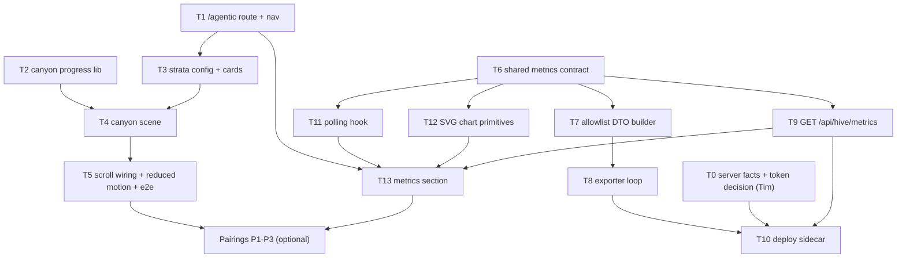

# Agentic Tab Implementation Plan

> **For agentic workers:** REQUIRED SUB-SKILL: Use superpowers:subagent-driven-development (recommended) or superpowers:executing-plans to implement this plan task-by-task. Steps use checkbox (`- [ ]`) syntax for tracking.

**Goal:** Add a top-level **Agentic** tab (`/agentic`) with two independent sections: a scroll-driven cartoon canyon
that reveals the pillars holding up the site, and a live, auto-refreshing panel of Hive metrics.

**Architecture:** One new front-end feature folder (`front-end/src/features/agentic/`). The canyon is inline SVG plus
CSS driven by a single `--p` custom property that a scroll hook writes. The metrics come from a sidecar container in
the existing pod that holds the Hive token, polls a fixed allowlist of Hive endpoints and writes an allowlisted JSON
file; the back-end serves that file at `GET /api/hive/metrics`; the front-end polls it every 60 s and draws its own
SVG charts.

**Tech Stack:** Bun workspace, React 19, react-router, Tailwind CSS v4, Fastify, `bun:test` with
`renderToStaticMarkup`, Playwright e2e, rootless `podman kube play`.

**Specs:**
- Canyon: [`docs/superpowers/specs/2026-11-02-agentic-canyon-animation-design.md`](../specs/2026-11-02-agentic-canyon-animation-design.md)
- Metrics: [`docs/superpowers/specs/2026-11-02-agentic-hive-metrics-design.md`](../specs/2026-11-02-agentic-hive-metrics-design.md)
- Pairings (optional): [`docs/superpowers/specs/2026-11-02-agentic-tab-pairings.md`](../specs/2026-11-02-agentic-tab-pairings.md)
- Research: [`research/hive_metrics_api.md`](../../../research/hive_metrics_api.md)

## Global Constraints

- No new dependencies (no chart, animation or validation library).
- TDD per `AGENTS.md`: one failing test, confirm it fails for the right reason, implement, run the full suite.
  Behaviour, not class strings.
- Quality gates after every task: `bun run test`, `bun run typecheck`, `bun run lint`, `bun run build`. E2E via
  `scripts/e2e.sh` on a podman host.
- One task = one GitHub issue = one branch `<type>/<number>-<slug>` = one PR with `Fixes #<number>`.
- Never publish a Hive field outside the allowlist in the metrics spec ("Public contract").
- Check light and dark mode for every surface that is not the canyon scene; WCAG 2.2 AA (`BRANDING.md` §6).
- Tasks touching `deploy/**` are high risk (`docs/risk-tiers.md`): the maintainer merges them.

## Order



The canyon track (T2-T5) and the metrics track (T6-T13) are independent after T1 and can run in parallel.

---

### T0: Server facts and token decision (Tim, no code)

- [ ] **Step 1:** On the server, run the read-only checks in `research/hive_metrics_api.md` §Q6 and record in the
  issue: Hive's bind address on 3001 (`ss -ltnp 'sport = :3001'`), whether `/api/status` answers 401 (auth on) or 200
  (open spoke), and which layer answers (gateway, Node proxy, or Go).
- [ ] **Step 2:** If `/api/status` answers 200 without a token, set Hive's `auth_token` first (Hive config, outside
  this repo).
- [ ] **Step 3:** Decide token placement (metrics spec, Open decisions 1) and the optional public fields (Open
  decisions 2). The rest of this plan assumes the recommended sidecar and no optional fields.

**Acceptance:** the issue states `HIVE_BASE_URL` (`host.containers.internal:3001` or `127.0.0.1:13001`), whether a
token is needed, and the token decision.

---

### T1: `/agentic` route, nav tab and server route lists

**Files:**
- Modify: `shared/src/index.ts` (add `AGENTIC_PAGE_PATH = "/agentic"`)
- Modify: `front-end/src/App.tsx` (route), `front-end/src/shared/components/top-bar.tsx` (`navLinks`: Agentic after Projects)
- Modify: `front-end/server/handler.ts` (`APP_ROUTE` accepts the path), `front-end/server/seo.ts` (`STATIC_PAGE_PATHS`, `llms.txt` list)
- Create: `front-end/src/features/agentic/pages/agentic-page.tsx` (shell: `<main id={MAIN_CONTENT_ID}>` with an `h1`)
- Tests: `test/front-end/src/App.test.tsx`, the top-bar test under `test/front-end/src/shared/components/`, `test/front-end/server/handler.test.ts`, `test/front-end/server/seo.test.ts`

- [ ] **Step 1:** Failing test: `/agentic` renders the Agentic page heading (route table test in `App.test.tsx`).
- [ ] **Step 2:** Add the constant, route and page shell. Pass.
- [ ] **Step 3:** Failing test: the top bar lists Agentic and marks it active on `/agentic` and `/agentic#x`, desktop
  and mobile sheet. Implement. Pass.
- [ ] **Step 4:** Failing test: the production handler answers `/agentic` and `/agentic/` with the SPA (not the
  not-found meta). Implement via `APP_ROUTE`. Pass.
- [ ] **Step 5:** Failing test: sitemap and `llms.txt` include `/agentic`. Implement. Pass.
- [ ] **Step 6:** Full suite, gates, commit `feat(agentic): add the Agentic tab route (#<n>)`.

**Acceptance:** the tab is reachable from the nav on desktop and mobile, deep links load in production, sitemap lists it.

---

### T2: Canyon progress library (pure)

**Files:**
- Create: `front-end/src/features/agentic/lib/canyon-progress.ts`
- Test: `test/front-end/src/features/agentic/lib/canyon-progress.test.ts`

**Interfaces:**
```ts
export function scrollProgress(m: { trackTop: number; trackHeight: number; viewportHeight: number }): number; // 0..1
export function revealedStrata(p: number, count: number): number;          // stratum i revealed when p >= (i + 0.5) / count
export interface CanyonMotion { sticky: boolean; scrollLinked: boolean; ambient: boolean; staticProgress: number | null }
export function resolveCanyonMotion(env: { prefersReducedMotion: boolean }): CanyonMotion;
```

- [ ] **Step 1:** Failing test: `scrollProgress` is 0 while the track is below the viewport top, 1 once its end has
  passed, linear in between; a track no taller than the viewport yields 1 once reached (no division by zero).
- [ ] **Step 2:** Implement. Pass.
- [ ] **Step 3:** Failing test: `revealedStrata` boundaries for 6 strata: `p = 0` → 0, just below `0.5/6` → 0, at
  `0.5/6` → 1, `p = 1` → 6, out-of-range `p` is clamped.
- [ ] **Step 4:** Implement. Pass.
- [ ] **Step 5:** Failing test: reduced motion → not sticky, not scroll-linked, no ambient loops, `staticProgress: 0.5`;
  otherwise all on and `staticProgress: null`. Implement. Pass.
- [ ] **Step 6:** Full suite, gates, commit.

---

### T3: Strata config, stratum cards and rim project flags

**Files:**
- Create: `front-end/src/features/agentic/config/canyon-strata.ts` (six strata: `id`, `heading`, `sentence`, `pillars[]`, `sourceLinks[]`; content from the canyon spec's layer table)
- Create: `front-end/src/features/agentic/components/canyon-stratum-card.tsx`
- Create: `front-end/src/features/agentic/components/canyon-rim.tsx` (site name + one flag per published project, using the loader `projects-page.tsx` already uses)
- Modify: `front-end/src/features/agentic/pages/agentic-page.tsx`
- Tests: `test/front-end/src/features/agentic/components/*.test.tsx`

- [ ] **Step 1:** Failing test: the page renders six `h2` stratum headings in rim-to-bedrock order (Content,
  Interface, API, Quality, Delivery, Agents · Hive), each with its pillars as a list and each with an `id` for deep links.
- [ ] **Step 2:** Implement config and card. Pass.
- [ ] **Step 3:** Failing test: the rim renders one link per project to `/projects/:slug`, and renders nothing (no
  error box) when the project list fails.
- [ ] **Step 4:** Implement. Pass.
- [ ] **Step 5:** Tim reviews the copy (voice rules, `BRANDING.md` §5). Full suite, gates, commit.

---

### T4: Canyon scene (static, `--p`-driven)

**Files:**
- Create: `front-end/src/features/agentic/components/canyon-scene.tsx` (inline SVG: sky layers, sun discs, stars, moon, mirrored walls with strata bands, bedrock hexagons, water layers, tablets)
- Create: `front-end/src/features/agentic/canyon-scene.css` (`--canyon-*` colours from the spec's colour table, `calc()` rules on `--p`, ambient keyframes behind `prefers-reduced-motion: no-preference`)
- Modify: `front-end/src/index.css` (`@import` the scene CSS)
- Tests: `test/front-end/src/features/agentic/components/canyon-scene.test.tsx`

- [ ] **Step 1:** Failing test: the scene root is `aria-hidden="true"` and contains one tablet per stratum, labelled
  from the same config as the cards (so art and text cannot drift).
- [ ] **Step 2:** Implement the SVG from `docs/assets/agentic/canyon-storyboard.svg` (geometry and colours). Pass.
- [ ] **Step 3:** Failing test: each stratum element carries `data-revealed` from a `revealed` prop count.
  Implement. Pass.
- [ ] **Step 4:** Write the CSS: every moving part uses only `transform` and `opacity`; colour changes are opacity
  crossfades between pre-painted layers (spec, "Scroll mechanics").
- [ ] **Step 5:** Visual check in the dev server at three fixed `--p` values (set in devtools) against the storyboard.
  Full suite, gates, commit.

---

### T5: Scroll wiring, reduced motion and e2e

**Files:**
- Create: `front-end/src/features/agentic/hooks/use-canyon-progress.ts` (passive scroll/resize listener, one rAF per frame, writes `--p` on the track, updates the revealed count only when it changes)
- Modify: `agentic-page.tsx` (track layout: `100svh + strata × 70svh`, 60svh on phones; sticky scene under the top bar; cards in the track)
- Create: `e2e/agentic-canyon.e2e.ts`

- [ ] **Step 1:** Failing e2e: at the top of the track no stratum is revealed; scrolled to the track's end all six are;
  `/agentic#quality` lands with Quality revealed.
- [ ] **Step 2:** Implement the hook and layout. Pass.
- [ ] **Step 3:** Failing e2e with `reducedMotion: "reduce"`: all strata revealed on load and the scene is not sticky
  (its top moves with the page). Implement through `resolveCanyonMotion`. Pass.
- [ ] **Step 4:** Light and dark screenshots of golden hour, sunset and night for the PR; performance trace on a
  throttled mobile profile shows no layout or paint in the scene per scroll frame.
- [ ] **Step 5:** Full suite, gates, commit.

---

### T6: Shared metrics contract

**Files:**
- Modify: `shared/src/index.ts` (`ROUTES.HIVE_METRICS = "/hive/metrics"`; export `HivePublicMetrics`, `HiveMetricsResponse`, `HIVE_METRICS_STALE_AFTER_MS = 600_000`)
- Test: `test/shared/src/routes.test.ts`

- [ ] **Step 1:** Failing test: the route is listed and unique among `ROUTES`. Implement. Pass.
- [ ] **Step 2:** Add the types exactly as in the metrics spec ("Public contract"). Typecheck, commit.

---

### T7: Allowlist DTO builder (pure)

**Files:**
- Create: `back-end/src/features/hive/hive-public-metrics.ts`
- Create: `test/back-end/src/features/hive/fixtures/` (recorded or hand-built Hive responses for the five endpoints, shaped from Hive's Go structs cited in the research; each fixture includes canary values: a repo `owner/secret-repo`, an issue title, a session id, a login URL, a USD cost)
- Test: `test/back-end/src/features/hive/hive-public-metrics.test.ts`

**Interfaces:**
```ts
export interface HiveUpstream { health: unknown; status: unknown; throughput: unknown; tokens: unknown; trend: unknown }
export function buildHivePublicMetrics(upstream: HiveUpstream, now: Date): HivePublicMetrics;
```

- [ ] **Step 1:** Failing test: built from the fixtures, the serialised output contains none of the canaries and
  has exactly the contract's keys.
- [ ] **Step 2:** Implement by picking fields into fresh objects. Pass.
- [ ] **Step 3:** Failing tests, one at a time: governor mode is lower-cased and unknown modes are rejected; agent
  counts come from states, not names; hourly buckets are summed into UTC days (`bucket_seconds`); trend history is cut
  to 7 days and at most one point per hour; token series keeps `t` and the summed total only.
- [ ] **Step 4:** Failing test: a non-number where a number is expected makes that part `null`/empty, never `NaN`,
  and never throws for the whole object. Implement. Pass.
- [ ] **Step 5:** Full suite, gates, commit.

---

### T8: Exporter loop

**Files:**
- Create: `back-end/src/scripts/hive-metrics-exporter.ts` (entry: reads `HIVE_BASE_URL`, optional `HIVE_DASHBOARD_TOKEN`, `HIVE_METRICS_PATH`)
- Create: `back-end/src/features/hive/hive-exporter.ts` (testable core: injected `fetch`, clock and writer)
- Test: `test/back-end/src/features/hive/hive-exporter.test.ts`

- [ ] **Step 1:** Failing test with fake clock and fetch: health and status are requested every 60 s, the three
  history endpoints every 180 s, all with GET, a 5 s timeout and the bearer header only when a token is set; the
  request URLs are exactly the spec's list.
- [ ] **Step 2:** Implement. Pass.
- [ ] **Step 3:** Failing test: one failing endpoint keeps the previous value for its part; a failing health check
  sets `online: false`; the file is written via temp file + rename.
- [ ] **Step 4:** Implement. Pass. Full suite, gates, commit.

---

### T9: `GET /api/hive/metrics`

**Files:**
- Create: `back-end/src/features/hive/register-hive-metrics-route.ts`
- Modify: `back-end/src/app.ts` (register inside the `API_BASE` plugin; path from `HIVE_METRICS_PATH`, default unset → `unavailable`)
- Test: `test/back-end/src/features/hive/register-hive-metrics-route.test.ts` (Fastify `inject`)

- [ ] **Step 1:** Failing test: no file → 200 `{ state: "unavailable", metrics: null }`.
- [ ] **Step 2:** Implement. Pass.
- [ ] **Step 3:** Failing tests: fresh file → `live`; file older than 10 minutes → `stale`; corrupt file after a good
  one → last good value; corrupt file first → `unavailable`; never 500; `Cache-Control: public, max-age=30`.
- [ ] **Step 4:** Implement (re-read only on mtime change). Pass. Full suite, gates, commit.

---

### T10: Deploy the sidecar (high risk, maintainer merges)

**Files:**
- Modify: `deploy/kube/prod.yaml` (container `hive-metrics`: back-end image, `command: ["bun", "run", "src/scripts/hive-metrics-exporter.ts"]`, no `ports`, env `HIVE_BASE_URL` from T0, `HIVE_METRICS_PATH=/data/hive-metrics.json`, `HIVE_DASHBOARD_TOKEN` via `valueFrom.secretKeyRef`, `views-data` mounted at `/data`; back-end gets `HIVE_METRICS_PATH`)
- Modify (only if T0 found Hive on loopback): `deploy/systemd/podman-kube@.service` `--network pasta:--host-lo-to-ns-lo,-T,13001:3001`
- Modify: `deploy/kube/dev.yaml` (back-end `HIVE_METRICS_PATH` pointing at a checked-in fixture; no exporter)
- Modify: `docs/deploy.md` (create the Kubernetes Secret on the host, never in the repo; how to check the export)
- Test: `test/shared/src/deploy-config.test.ts`

- [ ] **Step 1:** Failing test: in `prod.yaml` the `hive-metrics` container publishes no ports, reads the token only
  through `secretKeyRef`, and no other container references the secret.
- [ ] **Step 2:** Implement manifests and runbook. Pass.
- [ ] **Step 3:** On the server: create the secret, replay the pod, then `curl -s https://buildwithtim.dev/api/hive/metrics`
  shows `state: "live"`, and grepping the response for the repo owner, `usd` and `session` finds nothing.
- [ ] **Step 4:** Full suite, gates, commit; PR labelled for maintainer merge.

---

### T11: Polling hook

**Files:**
- Create: `front-end/src/shared/hooks/use-polling-api-get.ts` (separate from `useApiGet`, whose `start` clears data on purpose)
- Test: `test/front-end/src/shared/hooks/use-polling-api-get.test.ts`

- [ ] **Step 1:** Failing test on the pure reducer: an error after a success keeps the data and marks it stale; a
  success clears stale.
- [ ] **Step 2:** Implement. Pass.
- [ ] **Step 3:** Failing test with fake timers and a fake `document.visibilityState`: polls every 60 s while
  visible, none while hidden, fetches at once on becoming visible when the last fetch is over 60 s old, stops on unmount.
- [ ] **Step 4:** Implement. Pass. Full suite, gates, commit.

---

### T12: SVG chart primitives

**Files:**
- Create: `front-end/src/features/agentic/lib/chart-scale.ts` (pure: linear scale, nice min/max, path points)
- Create: `front-end/src/features/agentic/components/charts/{sparkline,bar-series,share-bar}.tsx`
- Tests: `test/front-end/src/features/agentic/lib/chart-scale.test.ts`, `.../components/charts/*.test.tsx`

- [ ] **Step 1:** Failing tests for the scale: empty and single-point series, all-zero series (flat line, no
  division by zero), negative values rejected.
- [ ] **Step 2:** Implement. Pass.
- [ ] **Step 3:** Failing tests per chart: renders a `<figure>` with caption, `role="img"` and a summary
  `aria-label` computed from the data, and a "Show data" table with every value.
- [ ] **Step 4:** Implement with site tokens and the categorical colours from the metrics spec; verify 3:1 against
  both wells. Pass. Full suite, gates, commit.

---

### T13: Metrics section

**Files:**
- Create: `front-end/src/features/agentic/components/hive-metrics-section.tsx`, `hive-status-pill.tsx`, `hive-kpi-tiles.tsx`
- Modify: `agentic-page.tsx` (section after the canyon track)
- Create: `e2e/agentic-metrics.e2e.ts`

- [ ] **Step 1:** Failing tests: the section renders the live, stale, offline (`online: false`) and unavailable
  states; the status pill text and `aria-live="polite"`; labels say "opened by Hive's agents" and "merged PRs and
  completed issues" (metrics spec, Layout 3-4); ACMM level shows its name.
- [ ] **Step 2:** Implement following `docs/assets/agentic/metrics-wireframe.svg`. Pass.
- [ ] **Step 3:** Failing e2e against the dev fixture: four tiles and four figures; with the route stubbed to
  `unavailable`, the explanation shows and no empty chart does. Implement. Pass.
- [ ] **Step 4:** Light and dark screenshots for the PR. Full suite, gates, commit.

---

### T14: Docs

- [ ] Add the public Hive metrics to `docs/metrics/README.md` (what is published, from where, cadence, what is
  deliberately excluded).
- [ ] Add the Agentic tab to the README's feature list if it has one.

---

### Pairings (optional, after T5 and T13)

One issue each, from [`2026-11-02-agentic-tab-pairings.md`](../specs/2026-11-02-agentic-tab-pairings.md):

- **P1 Bedrock hand-off:** "This layer is live ↓" link on the Agents · Hive card; honey bedrock colour as the Hive
  series colour.
- **P2 Night-to-page fade:** metrics section starts inside the canyon's final fade.
- **P3 Stars are merges:** star count from `throughput7d.merged`, capped, default stars when metrics are unavailable.
