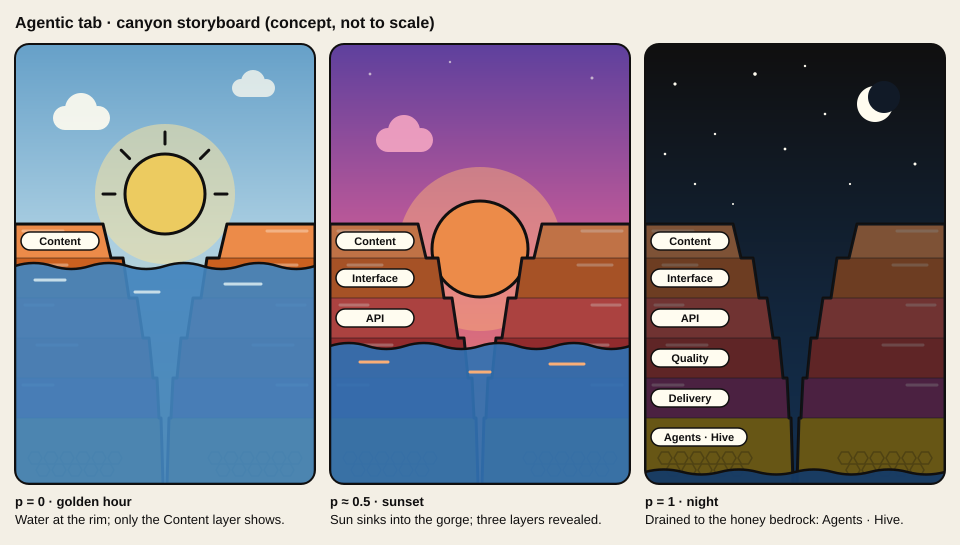
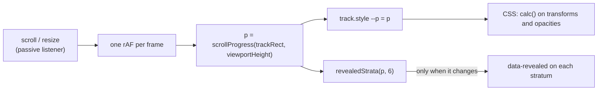

# Agentic Tab: Canyon Animation Design

Issue: #1046. Companion specs: [`2026-11-02-agentic-hive-metrics-design.md`](2026-11-02-agentic-hive-metrics-design.md)
(the section after this one) and [`2026-11-02-agentic-tab-pairings.md`](2026-11-02-agentic-tab-pairings.md)
(optional ways to make the two feel like one page). This spec stands on its own: the canyon ships without the
metrics section, and the metrics section without the canyon.

## Context

- The site has three top-level tabs, `Home`, `Articles` and `Projects`, listed in `navLinks`
  (`front-end/src/shared/components/top-bar.tsx:18-22`) and routed in `AppRoutes` (`front-end/src/App.tsx:17-32`).
- The front-end has no animation library and no chart library (`front-end/package.json`); motion today is Tailwind
  transitions behind `motion-safe:` / `motion-reduce:` (`front-end/src/features/articles/lib/articles-page-styles.ts:62-63`)
  and a pure `resolveArticleMotion` policy (`front-end/src/features/articles/lib/article-motion.ts`).
- The palette is Flexoki in dark mode and a warm paper theme in light mode (`BRANDING.md` §6). The site uses Flexoki's
  greys for surfaces and only its 200-step accents for code highlighting (`front-end/src/index.css:268-302`).
- Hive is the agent system that files, claims and lands work in this repo (`docs/multi-agent.md`, "Agents" table).

## Product goal

Show, in one memorable scroll, what holds the site and its projects up, ending on the layer that does the digging:
Hive and the other agents. The page should feel like a departure from the rest of the site (a scene, not a document)
while still being recognisably the same site: same type, same nav, same palette family.

Voice rules from `BRANDING.md` §5 apply to every label: name real tools and files, no invented numbers.

## The scene

A Grand Canyon seen head-on and built like a layered paper-cut diorama, with the sun sitting in the V of the gorge.
The final frames are in [`docs/assets/agentic/round-2/`](../../assets/agentic/round-2/README.md) (see "Fidelity and
design rounds").

| Element | Look | Changes with scroll progress `p` (0 → 1) |
| --- | --- | --- |
| Sky | Stepped bands of cut paper with gently wavy edges, one Flexoki step per band | Golden hour (`p = 0`) → sunset (`≈ 0.45`) → dusk (`≈ 0.75`) → night (`1`) |
| Sun | Stacked paper discs (glow rings, disc, highlight), paper ray wedges at golden hour only | Sinks from mid-sky into the gorge and behind the far gorge floor by `p ≈ 0.7`; yellow → orange → red; glow shrinks |
| Stars, moon | Small paper-white dots and four-point sparkles, a paper crescent on two halo discs | Fade in from `p ≈ 0.6`; moon from `p ≈ 0.8` |
| Depth planes | Three far ridgelines, mid buttes, two receding inner gorges, foreground outcrops | Each moves at its own rate with `p` (parallax) |
| Rim cap | A pale caprock band above stratum 1, carrying a rope bridge with the site name and the project flags | Never under water, so it is visible from `p = 0` |
| Canyon walls | Two stepped walls, one ledge per stratum; each stratum a paper strip with an overhanging lighter lip, a darker bedding strip, arched alcoves and fissures | Static shape; sunset and night tint overlays fade in with `p` |
| Strata | One horizontal band per pillar layer (see below), rim to bedrock; one hoodoo pillar per pillar item on its ledge | Each is "revealed" when the water drops below it |
| Water | Stacked translucent vellum strips with wavy edges, a torn foam edge at the walls; the drowned strata edges show through | Surface drops from the foot of the rim cap (`p = 0`) to just above the floor (`p = 1`); colour darkens with the sky; the sun's or moon's reflection is a broken column of paper slips |
| Tablets | One pinned paper tag per stratum carrying the layer name | Slides/fades in when its stratum is revealed |
| Bedrock | Honey-coloured band of cut hexagon tiles with a lit corner each | Last to appear: the Hive layer |

Paper-cut style means: every shape is a flat sheet with a slightly irregular, hand-cut edge and its own offset
shadow (a copy of the shape in `#100F0F`, Flexoki `black`, at 12–40 % opacity, shifted a few pixels; no `filter`).
Depth comes from stacked sheets and their shadows, not from outlines: there are no ink outlines. No gradients on solid
objects, no textures, no blur filters, no photographs. Round 2 (#1052) replaced the earlier "cartoon style" (3 px
ink outline) after Tim picked this direction in round 1 (#1051).

Ambient, time-based loops (all `motion-safe:` only): the water surface drifts sideways (one wave length per ~6 s), the
sun glow breathes (~4 s), stars twinkle at staggered delays. Nothing loops faster than once per 2 s and nothing flashes
(WCAG 2.3.1).

### Colour

The scene uses Flexoki's accent ramps, which the site does not use for surfaces anywhere else; that is the
"clear departure" while staying inside the site's palette family. Values from the Flexoki README
(<https://github.com/kepano/flexoki>, "Accent colors" tables).

| Role | Flexoki token | Hex |
| --- | --- | --- |
| Golden sky bands, top → horizon | blue-300 → blue-200 → blue-150 → blue-100 → yellow-50 → yellow-100 → yellow-150 | `#66A0C8` → `#92BFDB` → `#ABCFE2` → `#C6DDE8` → `#FAEEC6` → `#F6E2A0` → `#F1D67E` |
| Sunset sky bands | purple-600 → purple-500 → magenta-500 → magenta-400 → red-300 → orange-300 → orange-200 | `#5E409D` → `#735EB5` → `#B74583` → `#CE5D97` → `#E8705F` → `#EC8B49` → `#F9AE77` |
| Night sky bands | black → blue-950 → blue-900 → blue-850 | `#100F0F` → `#101A24` → `#12253B` → `#133051` |
| Sun (golden → set) | yellow-200 → orange-300 → red-400 | `#ECCB60` → `#EC8B49` → `#D14D41` |
| Rim cap | orange-150, layer orange-200, lit edge orange-100 | `#FCC192`, `#F9AE77`, `#FED3AF` |
| Strata, rim → deep | orange-300, orange-500, red-400, red-600, magenta-700; each with a lighter lip (one step lighter) and darker recesses | `#EC8B49`, `#CB6120`, `#D14D41`, `#AF3029`, `#87285E` |
| Bedrock (Hive) | yellow-500, tiles yellow-400, lit corners yellow-200 | `#BE9207`, `#D0A215`, `#ECCB60` |
| Water strips (golden, surface → deep) | blue-150 → blue-300 → blue-400 → blue-500 → blue-600 | `#ABCFE2` → `#66A0C8` → `#4385BE` → `#3171B2` → `#205EA6` |
| Water strips (sunset) | magenta-300 → blue-600 → purple-700 → purple-800 | `#E47DA8` → `#205EA6` → `#4F3685` → `#3C2A62` |
| Water strips (night) | blue-800 → blue-900 → blue-950 | `#163B66` → `#12253B` → `#101A24` |
| Project flags (paper text) | blue-600, green-700, purple-600 | `#205EA6`, `#536907`, `#5E409D` |
| Paper shadows, site-name sign | black | `#100F0F` |
| Stars, tablets, sign lettering | paper | `#FFFCF0` |

The scene is the same in light and dark mode: it carries its own sky. Everything that is not the scene (top bar, text
cards, the fade into the next section) uses the existing theme tokens, so both themes still apply around it.

Tablet text is `#100F0F` on `#FFFCF0` (18.6:1), and the site-name sign is the reverse. Flag text is paper on blue-600
(6.4:1), green-700 (6.0:1) and purple-600 (7.6:1); green-600 would only reach 4.4:1. The sign and flags sit above
the sunset and night tints, so their contrast does not depend on `p`. Any other copy placed over the scene sits on a
solid `--card` / `--card-foreground` surface, never directly on the sky.

### Fidelity and design rounds

Tim's review on 2026-11-02 accepted the concept: the composition, the sunset-to-night arc, the falling water and
the strata as pillars. He found the storyboard's art "low on polygons", too basic. The storyboard fixes **layout and
story only**. The final scene must be visibly richer, so its art is settled in design rounds before the scene is built
(plan task T4). Each round is its own issue and produces static frames that Tim reviews in the PR.

| Round | Output | Decision it asks for |
| --- | --- | --- |
| 1. Art direction | 2–3 distinct directions, each drawn as golden hour, sunset and night frames at desktop size (inline SVG + CSS, the same constraints as production) | Which direction to develop |
| 2. Refinement | The chosen direction at desktop and phone sizes, with all six strata, pillars, tablets and the rim projects; light and dark page chrome around it | Final art, sign-off of the frames |
| 3. Motion study | A throwaway scroll prototype of the chosen art (not merged into the app) with the real `--p` mechanics, ambient loops and the reduced-motion frame | Timing, easing and whether it holds 60 fps on a phone |

**Round 1 result (#1051, frames in [`docs/assets/agentic/round-1/`](../../assets/agentic/round-1/README.md)):** Tim
picked direction B, the paper-cut diorama.

**Round 2 result (#1052, frames in [`docs/assets/agentic/round-2/`](../../assets/agentic/round-2/README.md)):** B at
desktop (1440×900) and phone (390×844) sizes for golden hour, sunset and night, plus the desktop sunset frame inside
the light and dark page chrome. The README there lists the layer ids, the parallax rate per layer, the `--p`
crossfade and transform map and the node counts (about 410–425 per frame; about 670 estimated for the production
scene with every time-of-day variant). Decisions recorded there:

- **Golden hour and the waterline:** the rim is a separate rim cap above stratum 1 that is never part of the reveal.
  At `p = 0` the water sits at the cap's foot (the top of stratum 1), so the rim, the site name, the flags and
  Content's hoodoos are visible from the first frame; the calm water mirrors the rim skyline until `p ≈ 0.3`. The
  waterline stays `top of stratum 1 + 6 × band height × p` and the reveal rule `(i + 0.5) / 6` is unchanged.
- **Layout:** on desktop the gorge axis sits at x = 880 of 1440 and every tablet is on the right wall, so nothing
  carrying meaning sits under the `max-w-md` card column; on phone the strata, tablets and rim fit above the
  bottom third, where the cards sit.

**Round 3 result (#1053, prototype and measurements in
[`docs/assets/agentic/round-3/`](../../assets/agentic/round-3/README.md)):** the round-2 art holds 60 fps with no
long frames and no per-frame layout or paint. I measured this in headless Chromium with CPU throttled 4×, on a phone
profile (390×844 at DPR 3) and on desktop (1440×900). Getting there took three structural rules, which the scene in
T4 follows:

- **One composited box per layer.** Each layer is its own `<svg>` in an absolutely positioned box cropped to the rows
  its art uses. CSS transforms on `<g>` elements inside one SVG ran layout and paint on every frame and dropped to
  53 fps.
- **`--p` does not inherit.** `--p` is registered with `@property … { inherits: false }` and written on each driven
  layer box. Style recalc dropped from 7.1 to 2.2 ms per frame on the throttled phone.
- **Drowned strata fade per stratum.** Each stratum's drowned edges fade out on `data-revealed`. A clip at the
  moving waterline repainted about 8 times a frame.

The README there lists the timing, easing and rate of every layer. The art needs no redrawing. The three far
ridgelines now move as one plane, as do the two inner gorges. The remaining risk is texture memory on phones, about
170 MB at DPR 3. It needs a trace on a real device in T5, and the README lists the optional art cuts if that trace
shows pressure.

What "richer" should explore, within the performance rules in "Scroll mechanics":

- **Depth:** three or more parallax ridgelines (far mesas in haze, mid buttes, near walls) instead of one wall pair,
  each moving at its own rate with `p`.
- **Rock detail:**
  - Faceted strata: several polygons per band with lit and shadowed faces, erosion notches, talus slopes at the
    ledges.
  - Hoodoo pillars standing on the ledges, one per pillar item, so "pillars" is literal.
  - Bedrock with a honeycomb pattern that catches the light.
- **Light:**
  - A rim light on the sun-facing edges.
  - Cast shadows that lengthen as the sun sinks, done with pre-drawn shadow layers crossfaded by opacity.
  - A warm glow that fades to a cool moonlit palette.
- **Water:**
  - The sun's and moon's reflection as a broken column of strokes.
  - Layered wave bands, and foam lines at the walls.
  - A visible tide line on each revealed stratum.
- **Atmosphere:** clouds in two layers, mist in the gorge at dusk, birds crossing at golden hour, stars and a
  slow-moving satellite or meteor at night.

Budget for the final art (checked in round 3):

- Under ~1,500 SVG nodes.
- No `filter` on large areas.
- Per frame, only `transform` and `opacity` change.
- Ambient loops pause when the scene is off-screen.

## The layers (pillars)

Six strata, rim to bedrock. Each stratum has a short heading, one plain sentence, and the pillars (concrete tools or
files) it reveals. All of it is real DOM text in reading order; the drawn tablets only repeat the heading.

| # | Stratum | Pillars it reveals | Source of truth |
| --- | --- | --- | --- |
| 1 | Content | Markdown in Obsidian, `content/`, the Obsidian content pipeline | `content/`, `docs/content-authoring.md` |
| 2 | Interface | React 19, Vite, Tailwind CSS v4, shadcn/Radix | `front-end/package.json` |
| 3 | API | Fastify, shared contracts, SQLite view counts | `back-end/src/app.ts`, `shared/src/index.ts`, `back-end/src/features/views/view-store.ts` |
| 4 | Quality | TDD with `bun:test`, Playwright e2e, Stryker mutation testing, coverage floors | `docs/testing.md`, `docs/metrics/README.md` |
| 5 | Delivery | GitHub Actions, merge queue, images on GHCR, `podman kube play` with an update timer and rollback, Cloudflare Tunnel | `.github/workflows/`, `docs/deploy.md`, `deploy/` |
| 6 | Agents · Hive | Hive's agents (scanner, architect, quality, craftsman, strategist), Claude Code in CI, Dependabot, coordinated through GitHub issues | `docs/multi-agent.md` |

The rim (above stratum 1) carries the site itself and its projects: the site name and one flag per published project,
read from the existing content list API (projects with `type: project`), each linking to `/projects/:slug`. The
stratum list lives in one config module so the copy can change without touching the scene; its order is the reveal
order.

Final wording of every sentence is Tim's call; the table above fixes the structure and the facts.

## Scroll mechanics

- **Layout:** a scroll track (`<section>`) whose height is `100svh + strata × 70svh`. Inside it, the scene is
  `position: sticky; top: <top-bar height>; height: 100svh - <top-bar height>`. The stratum text cards are ordinary
  blocks in the track, so they scroll past the pinned scene (scrollytelling). The top bar stays as it is on every page.
- **One number drives everything.** A hook measures the track and writes `--p` (0 → 1) on it; CSS derives every
  moving part from `--p` with `calc()` and `clamp()`. React does not re-render per frame. `data-revealed` attributes
  change only when a stratum crosses the waterline, which is also what tests observe.
- **Reveal rule:** stratum `i` (0-based, rim first) is revealed when `p ≥ (i + 0.5) / 6`, i.e. once the waterline
  has passed the middle of that band. The water's position is `p` itself, so text, tablet and waterline stay in sync.
- **Compositor-only per-frame work.** Colour changes are done as opacity crossfades between pre-painted layers
  (four sky layers, the sun discs, colour variants of the ridges, inner gorges and water, sunset and night tint
  overlays on the walls), and movement as `transform`. The full layer map is in
  `docs/assets/agentic/round-2/README.md`.
  No per-frame change to `fill`, `background`, `filter`, layout or SVG geometry. Ambient loops also animate only
  `transform` and `opacity`.
- **Why not CSS scroll-driven animations (`animation-timeline: scroll()`):** MDN marks the feature as not Baseline
  because it does not work in some widely used browsers
  (<https://developer.mozilla.org/en-US/docs/Web/CSS/Reference/Properties/animation-timeline/scroll>). The
  single-variable approach works everywhere, and the CSS is written so swapping to `animation-timeline` later only
  replaces the hook.
- **Why not canvas, WebGL or Lottie:** they add dependencies or opaque drawings that cannot be themed, tested as
  markup or read by assistive tech, and the brief asks for animated CSS.

### Responsive

- Phone (< 640 px): portrait composition. Walls narrower, gorge narrower, sun about 60 % of desktop size, tablets
  shortened (heading only). Stratum cards span the bottom third of the viewport. Track length per stratum drops to
  60svh.
- Tablet / desktop: cards sit in a left column (`max-w-md`) over the left wall; the gorge and sun stay visible on the
  right of centre. Wider than `max-w-screen-xl`, the scene fills the width and the walls extend.

### Accessibility

- The drawing is decorative: the scene's root is `aria-hidden="true"` and every bit of information it shows (layer
  names, pillars, projects) is in the text cards in reading order, as `<h2>` + list per stratum.
- `prefers-reduced-motion: reduce`: no sticky scene, no scroll coupling, no ambient loops. The page shows the scene
  once, as a static hero frozen at the sunset frame (`--p: 0.5`) with all tablets visible, followed by the strata as an
  ordinary list. The decision is a pure function, like `resolveArticleMotion`, so it is unit-tested.
- Keyboard: the only interactive elements are the project flags and source links in the cards; they are ordinary
  links in DOM order with the site's focus ring.
- Deep links: `/agentic#<stratum-id>` scrolls to that card; since `p` is derived from scroll position, the scene is
  automatically in the matching state.

### End of the scene

At `p = 1` the night sky's bottom edge fades into `--site-page-bg` over the last ~30svh of the track, so the next
section starts on the normal page background in both themes. What comes next is not part of this spec.

## Route and navigation

- New route `/agentic`, nav label **Agentic**, after Projects in `navLinks` (desktop and mobile sheet share the list).
- Every list of known routes must learn the path: `AppRoutes` (`front-end/src/App.tsx`), the production server's
  `APP_ROUTE` (`front-end/server/handler.ts:43`), sitemap `STATIC_PAGE_PATHS` and the `llms.txt` page list
  (`front-end/server/seo.ts:11`, `:43`). One shared constant for the path keeps them in step.
- The page gets its own title and description meta like the other static pages.

## Code layout

New feature folder `front-end/src/features/agentic/`, following the existing feature shape:

| File | Responsibility |
| --- | --- |
| `pages/agentic-page.tsx` | Page shell: canyon track, then whatever section follows |
| `components/canyon-scene.tsx` | The inline SVG + layered divs; reads only `--p` and `data-*` |
| `components/canyon-stratum-card.tsx` | One stratum's heading, sentence, pillars |
| `config/canyon-strata.ts` | The six strata (id, heading, sentence, pillars, source links) |
| `lib/canyon-progress.ts` | Pure: `scrollProgress`, `revealedStrata`, `resolveCanyonMotion` |
| `hooks/use-canyon-progress.ts` | Scroll/resize listener, rAF throttle, writes `--p` and `data-revealed` |
| `canyon-scene.css` | Keyframes and the `calc()` rules, `@import`ed from `front-end/src/index.css` |

No new dependencies. Colours that only the scene uses stay in `canyon-scene.css` as `--canyon-*` custom properties,
not in the site-wide token list.

## Testing and verification

TDD per `AGENTS.md`; behaviour, not class strings.

- Unit (`bun:test`): `scrollProgress` clamps to 0 before the track and 1 after it and is linear in between;
  `revealedStrata` boundaries (just below and at each threshold, `p = 0` reveals none, `p = 1` reveals all);
  `resolveCanyonMotion` turns off sticky/scroll/ambient motion under reduced motion.
- Render (`renderToStaticMarkup`): the page lists all six strata headings in rim-to-bedrock order with their pillars;
  the scene root is `aria-hidden`; project flags link to `/projects/:slug`; the nav contains Agentic and marks it
  active on `/agentic`; the production server answers `/agentic` with the SPA, not the not-found page.
- E2E (Playwright, `scripts/e2e.sh`): scrolling to the end of the track marks every stratum revealed; at the top none
  is; with `reducedMotion: "reduce"` every stratum is visible on load and the scene is not sticky; light and dark
  screenshots of the three keyframes for review.
- Manual: a performance trace on a mid-range phone profile shows no layout or paint per scroll frame in the scene
  (only composite), and the page holds 60 fps.

## Out of scope

- The metrics section and any data from Hive (separate spec).
- Sound, cursor effects, parallax on the top bar, or changing the theme toggle's behaviour on this page.
- A canvas, WebGL or Lottie renderer, even for a richer art direction (see "Scroll mechanics" for why).
