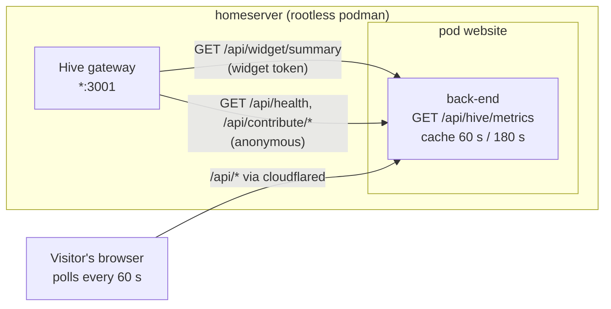

# Agentic Tab: Live Hive Metrics Design

Issue: #1046. Research: [`research/hive_metrics_api.md`](../../../research/hive_metrics_api.md). Every Hive claim below
is cited there to Hive's source or to a read-only check on the server. Companion specs:
[`2026-11-02-agentic-canyon-animation-design.md`](2026-11-02-agentic-canyon-animation-design.md) and
[`2026-11-02-agentic-tab-pairings.md`](2026-11-02-agentic-tab-pairings.md). This section stands on its own and works
without the canyon above it.


Revised after the PR #1047 review. Hive has a read-only **widget token**. The checks on the server showed:

- Hive's auth is on.
- The production website pod already reaches Hive.

So this design uses no owner credential, needs no sidecar, and changes nothing in the network.

## Product goal

Show visitors what Hive is doing on this server right now, using numbers Hive already computes, refreshed at least
every 5 minutes. The section backs the rest of the tab ("agents help build this site") with live evidence. It never
shows anything that would leak private work, spend or infrastructure.

Voice (`BRANDING.md` §5): every number is real and labelled with what it counts and when it was measured. If Hive is
down, the page says so.

## Research answer in short

| Question | Answer |
| --- | --- |
| Does Hive expose an API for its metrics? | Yes, JSON over HTTP (research Q1). |
| Does it serve rendered graphs? | No. Hive's own dashboard draws inline SVG in the browser (Q2). |
| Can the dashboard be embedded? | No. Every page sends `X-Frame-Options: DENY`, and on the server `/api/snapshot` is 404 (Q2, Q6). |
| Screenshot instead? | Rejected: it needs an owner session, and pixels can leak repository names (Q7c). |
| Can the browser call Hive directly? | No. There is no CORS, and Hive is not on the internet. Fetch server-side (Q1). |
| Read-only credential | The **widget token** (`X-Hive-Widget-Token`). It authenticates exactly `GET /api/widget/summary` and nothing else (Q1). The running `stable` image lists the route (Q6). |
| Anonymous data | `/api/health`, `/api/contribute/metrics`, `/api/contribute/run-stats` answer 200 without credentials on the server (Q6). |
| Network | No change: from inside the production back-end container, `host.containers.internal:3001/api/health` returns 200 (Q6). |
| Freshness | The widget `history` gains one point per governor eval (300 s by default). The contributor series are hourly (Q4, Q6). |

**Decision:** the website back-end fetches the widget summary and the anonymous endpoints. It caches them and serves
an allowlisted summary at `GET /api/hive/metrics`. The front-end polls it and draws its own charts. There is no
iframe, no screenshot, and no change to Hive or to the pod network.

## Architecture



The widget token can read one endpoint and nothing else. So the internet-facing back-end can hold it. If the
back-end is compromised, the attacker gets the same numbers this page already publishes, plus the fields we drop
(below). They get no mutation and no other route. The earlier sidecar existed only to keep an owner-equivalent token
out of the back-end. No owner token is involved now, so the sidecar is gone.

## Data

### Upstream calls (back-end only, GET, fixed URLs, no visitor input)

| Hive endpoint | Auth | Fields kept | Refresh |
| --- | --- | --- | --- |
| `GET /api/health` | none | `status === "ok"` → `online` | 60 s |
| `GET /api/widget/summary` | `X-Hive-Widget-Token` | `history[]`: `t`, `govMode`, `govIssues`, `govPrs`, `govHold`, `actionableCount`, `openPrCount`, `mergeableCount`. `agents[]`: count of all agents and of `state === "running"` | 60 s |
| `GET /api/contribute/metrics` | none | `collected_at`, `tasks_done[]`, `fleet_size[]` (hourly, 7 days) | 180 s |
| `GET /api/contribute/run-stats` | none | `window_days`, `total`, per backend: `backend`, `completed`, `failed`, `abandoned`, `duration_p50_s`, `duration_p95_s` | 180 s |

Dropped on purpose:

- From the widget summary:
  - `hiveId` (instance identifier).
  - `history[].repos` (repository names).
  - `history[].agentStats` and `agents_kicked` (agent names and internals).
  - `agents[].name`.
- From the contributor metrics: `per_user_done` and any `per_user_*` series (keyed by GitHub login).
- From run-stats: `models[]`, `scenarios` and `chrome_idle_share`.

Not requested:

- `/api/contribute/effective-models` and `/api/leaderboard` (see Open decisions).
- Everything that needs the owner token: `/api/status`, `/api/pr-throughput`, `/api/timeseries`,
  `/api/trend/history`, cost.
- `/api/snapshot`, `/api/events` and `/metrics`.

### Public contract

`HivePublicMetrics` lives in `shared/`, so the back-end route and the front-end type-check against one definition.
It holds only counts, durations, modes and timestamps:

```ts
type GovernorMode = "idle" | "quiet" | "busy" | "surge";   // Hive sends IDLE/QUIET/BUSY/SURGE (hive/src/pkg/governor/governor.go:19-22)

interface HivePublicMetrics {
  online: boolean;                                // /api/health
  hive: {                                         // /api/widget/summary; null without a working widget token
    mode: GovernorMode;                           // latest history point
    agents: { total: number; running: number };
    work: { issues: number; prs: number; held: number; actionable: number; mergeable: number };  // latest point
    history: { t: string; mode: GovernorMode; issues: number; prs: number; held: number }[];
  } | null;
  contributors: {                                 // /api/contribute/*; null when unavailable
    collectedAt: string;
    tasksPerHour: number[];                       // 168 hourly buckets, oldest first, aligned with fleetSize
    fleetSize: number[];
    runs7d: { total: number; backends: { backend: string; completed: number; failed: number; abandoned: number;
              p50Seconds: number | null; p95Seconds: number | null }[] };
  } | null;
}

interface HiveMetricsResponse {
  state: "live" | "stale" | "unavailable";
  fetchedAt: string | null;                       // when the back-end last got a good upstream answer
  metrics: HivePublicMetrics | null;
}
```

The builder picks fields into fresh objects. It never deletes fields from Hive's payload. It rejects any upstream
value that is not the expected primitive. Each of `hive` and `contributors` fails independently: a missing widget
token blanks the first, and the anonymous part still shows.

### Freshness and failure

- **Back-end:**
  - A single-flight in-memory cache: 60 s for health and the widget summary, 180 s for the contributor endpoints.
  - Each upstream call has a 5 s timeout. A failed call keeps the last good value for its part.
  - `state` is `live` when every part is fresh, `stale` when any part is older than 10 minutes, and `unavailable`
    when nothing has ever been fetched.
  - The response has `Cache-Control: public, max-age=30`. Existing rate limiting applies.
- **Front-end:**
  - Polls every 60 s while the tab is visible (Page Visibility API).
  - When the tab becomes visible again, it fetches at once if the last fetch is over 60 s old.
  - A failed poll keeps the last data on screen and marks it stale.
- **Worst-case delay** from Hive changing a value to the visitor seeing it:
  - Widget data: 60 s (cache) + 30 s (HTTP cache) + 60 s (poll) = 150 s.
  - Contributor series: 180 s + 30 s + 60 s = 270 s.

  Both are under the 5-minute requirement.
- **Upstream load** does not depend on visitor count: 2 calls per minute plus 2 every 3 minutes, all cheap. The
  heavy audit-log routes from the first draft are not called.

## Layout

The section follows the canyon. Without the canyon, it sits at the top of the page. It uses the normal page background
and the site's wells, so it follows light and dark mode like every other page.

1. **Header row.** Heading "The hive, live". One sentence: Hive is the agent system that files, claims and lands work
   in this repo, and these numbers come from the instance running on this server. A status pill shows one of
   `Live · updated 40 s ago`, `Stale · last update 14:05`, or `Offline`.
2. **KPI tiles** (four `Card`s, 2×2 on phones, 4 across from `lg`), all from the latest widget history point:
   - **Agents running:** `running / total`.
   - **Open work:** issues + PRs, with held as a sub-line.
   - **Ready to merge:** `mergeable` PRs, with `actionable` as a sub-line.
   - **Governor mode:** idle / quiet / busy / surge, with a one-line meaning ("how hard Hive is working the queue").
3. **Queue** (wide card): lines for issues, PRs and held over the span the history covers. The title states the
   measured span ("last 17 hours"), computed from the first and last `t`, never assumed.
4. **Governor mode** (card beside it): one horizontal band over the same span, split into segments coloured by mode,
   with a legend. Mode changes are rare, so this reads as a timeline of how busy the hive was.
5. **Contributor agents, last 7 days** (wide card):
   - Bars of tasks completed per hour, total in the caption.
   - A sub-line with the current fleet size ("1 contributor agent connected").
   - Caption: these are tasks done by contributor agents connected to this hive.
6. **Runs by backend, last 7 days** (card beside it): one row per backend with a stacked bar
   (completed / failed / abandoned) and that backend's p50 and p95 run time. Percentiles are per backend and are
   never summed or averaged across backends (research Q6).
7. **Footnote:**
   - What Hive is, with a link to <https://github.com/hivecommons/hive>.
   - How it works on this repo, with a link to `docs/multi-agent.md` on GitHub.
   - That repository names, agent names, cost and logs are deliberately not published.

If `hive` is null (no widget token yet), tiles 2 and charts 3–4 are replaced by one line: "Live queue data is not
connected yet." The contributor charts still show. If both parts are null, the section shows a short explanation
instead of empty charts.

### Charts

- Hand-rolled inline SVG components with no chart library. The site has none, and Hive's dashboard does the same
  (research Q2). Four primitives: `LineSeries`, `ModeBand`, `BarSeries` (plain/stacked), `StackedRow`.
- Colours:
  - Series use site tokens first: `--site-accent` for the headline series, the `--ink`/`--paper` ramp for secondary
    series.
  - Categorical series use Flexoki accents: 600 in light mode, 400 in dark mode. Each is checked at 3:1 against
    `--site-section-well-bg` (WCAG 1.4.11).
  - Governor modes run cool to warm: idle = base grey, quiet = blue, busy = orange, surge = red.
  - Colour is never the only cue: legends label every series, and mode segments carry text where they fit.
- Motion: on data change, values move with a 300 ms transform/opacity transition behind `motion-safe:`. There is no
  entrance animation.

### Accessibility

- Each chart is a `<figure>` with a `<figcaption>`. The SVG has `role="img"` and an `aria-label` that states the
  takeaway (e.g. "Open PRs over the last 17 hours: between 4 and 9, now 6").
- A `<details>` "Show data" element under each chart holds the numbers as a `<table>`.
- No `aria-live` on the charts, since a 60 s poll would be noise. Only the status pill is `aria-live="polite"`, and it
  announces state changes (live → stale → offline), not every refresh.
- Relative times use `<time datetime>`, with the absolute time in `title`.

## Configuration and deployment

| Setting | Where | Value |
| --- | --- | --- |
| `HIVE_BASE_URL` | back-end env, `deploy/kube/prod.yaml` | `http://host.containers.internal:3001` (verified from the production pod, research Q6) |
| `HIVE_WIDGET_TOKEN` | back-end env via `valueFrom.secretKeyRef` with `optional: true` | The widget token Tim mints in Hive. Kept in a podman secret created on the host and never in the repo. Without it the pod still starts (podman skips an optional missing secret, research Recommendation), and `hive` is null |
| Network flag | `deploy/systemd/podman-kube@.service` | unchanged |
| Dev | `deploy/kube/dev.yaml` | `HIVE_BASE_URL` unset → the route serves a checked-in fixture in development only. The dev pod publishes the back-end on host `127.0.0.1:3001`, which collides with Hive on a machine that runs both; the server runs only prod |

Not used (research Q5): `-T` port forwards, `hostNetwork`, `--map-gw` / `--map-host-loopback`, and joining
`hive.network`.

## Testing and verification

TDD per `AGENTS.md`.

- **Builder (pure):** built from recorded responses, the output keeps exactly the allowlisted fields. The fixtures
  carry canaries: a repo in `history[].repos`, agent names, `hiveId`, a `per_user_done` login. None of them may
  appear in the serialised output.
- **Builder (rules):**
  - Modes are lower-cased, and unknown modes are rejected.
  - `running` counts only `state === "running"`.
  - The latest point drives the tiles.
  - Malformed numbers become `null`/empty, never `NaN`, and never fail the whole object.
- **Route** (Fastify `inject`, fake fetch and clock):
  - The URLs requested are exactly the four above, as GET.
  - The widget header is sent only to the widget route.
  - TTLs are 60 s and 180 s.
  - One failing upstream keeps its last value.
  - No token → `hive: null` and the contributor part still served.
  - Nothing ever fetched → `unavailable`.
  - Never 500.
  - `Cache-Control: public, max-age=30`.
- **Front-end:**
  - The polling reducer keeps data on error and marks it stale.
  - Polling pauses while hidden and resumes on visible.
  - Each chart renders its summary `aria-label` and data table.
  - The section renders the live, stale, offline, widget-missing and unavailable states.
  - Run-time percentiles appear per backend only.
- **E2E:** with the dev fixture, four tiles and four figures appear. With the route stubbed to `unavailable`, the
  explanation shows and no empty chart does.
- **On the server after deploy:** `curl -s https://buildwithtim.dev/api/hive/metrics` shows `state: "live"`.
  Grepping the response for a repository name, `hiveId`, `github_username` or `usd` finds nothing.

## Open decisions (Tim)

1. **Mint the widget token** in Hive (`POST /api/widget/token` or the dashboard) and store it as the podman secret.
   Until then the section shows only the anonymous contributor data.
2. **PR throughput and "who merged the work"** are not reachable with the widget token. Options:
   - (a) Leave them out (default).
   - (b) Compute them from this repo's public GitHub PRs, reusing the source classification in
     `scripts/pr-metrics.ts`.
   - (c) Ask Hive upstream to add throughput to the widget summary.
   - (d) An owner-token sidecar, which was rejected earlier for risk.
3. **Optional anonymous extras:**
   - `/api/contribute/effective-models` (per-model merged PRs and first-pass merge rate). It reveals which model
     providers are paid for.
   - `/api/leaderboard` `agents[]` (agent account usernames and avatars).

   Both are excluded by default.
