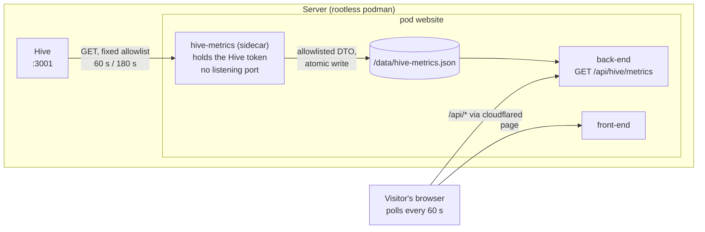

# Agentic Tab: Live Hive Metrics Design

Issue: #1046. Research: [`research/hive_metrics_api.md`](../../../research/hive_metrics_api.md) (every Hive claim
below is cited there to a file and line in Hive's source). Companion specs:
[`2026-11-02-agentic-canyon-animation-design.md`](2026-11-02-agentic-canyon-animation-design.md) and
[`2026-11-02-agentic-tab-pairings.md`](2026-11-02-agentic-tab-pairings.md). This section stands on its own: it works
without the canyon above it.


## Product goal

Show visitors what Hive is doing on this server right now, using numbers Hive already computes, refreshed at least every
5 minutes. The section proves the claim the rest of the tab makes ("agents help build this site") with live evidence,
and never shows anything that would leak private work, spend or infrastructure.

Voice (`BRANDING.md` §5): every number is real and labelled with what it counts and when it was measured. If Hive is
down, the page says so.

## Research answer in short

| Question | Answer (see research note) |
| --- | --- |
| Does Hive expose an API for its metrics? | Yes: JSON over HTTP, e.g. `/api/status`, `/api/pr-throughput`, `/api/timeseries`, `/api/trend/history` (research Q1). |
| Does it serve rendered graphs? | No. The dashboard draws hand-made inline SVG sparklines, donuts and CSS bars in the browser; the only server-side SVGs are leaderboard social cards (Q2). |
| Can the dashboard be embedded? | Practically no: every route sends `X-Frame-Options: DENY` / `frame-ancestors 'none'`. Only `/snapshot` can be framed, and it bakes status, config and audit data into public HTML (Q2, Q3). |
| Screenshot instead? | Possible only with a headless browser holding an owner session; pixels still leak repo names and titles (Q7c). Rejected. |
| Can the browser call Hive directly? | No: Hive sends no CORS headers and Hive is not on the internet. A server-side fetch is required anyway (Q1). |
| Auth | All metric routes need a dashboard token; Hive has no read-only API token, so the token is owner-equivalent (Q1). |
| Freshness | Hive's status is rebuilt every governor cycle (300 s default); histories gain at most one point per 5 min. `/api/pr-throughput` scans the audit log on every call, so it must be cached (Q4). |
| Network | The pod reaches a Hive bound to all interfaces at `host.containers.internal:3001` with no change; if Hive binds loopback only, one pasta flag `-T,13001:3001` is needed. Both were tested with `podman kube play` (Q5). |

**Decision:** build our own charts from an allowlisted JSON summary that the website produces server-side (research
option (a)). No iframe, no screenshots, no change to Hive.

## Architecture



### Why a sidecar holds the token, not the back-end

The back-end is reachable from the internet through cloudflared (`deploy/cloudflared/config.yml`). Hive's only token
for these routes is owner-equivalent (research Q1), so whoever compromises the process holding it owns Hive, and with
it Hive's GitHub credentials and agent sessions. A separate container in the same pod:

- holds the token (podman secret via `env.valueFrom.secretKeyRef`, which `podman kube play` supports:
  <https://docs.podman.io/en/latest/markdown/podman-kube-play.1.html>, "Kubernetes Secret");
- listens on no port, takes no input from visitors, and sends only a fixed list of GET requests;
- writes the already-allowlisted summary to a file on the pod's existing `/data` volume, which the back-end only reads.

It runs the back-end image with a different command (`bun run src/scripts/hive-metrics-exporter.ts`), so it is built,
pulled, updated and rolled back with the back-end by the existing `website-update` flow at no extra image cost.

Alternatives, in the order they were considered:

| Option | Why not (now) |
| --- | --- |
| Back-end fetches Hive itself with the token | Simplest, but puts an owner credential in the internet-facing process. Acceptable only if the server's Hive is already an open spoke (no token at all), which is a bigger problem to fix first. |
| Upstream Hive gets a read-only, route-scoped token | The right long-term fix; out of this repo and blocks the feature on upstream. When it exists, the sidecar can switch to it with no website change. |
| Host-side systemd timer running the exporter | Same isolation, but adds a host unit outside the pod lifecycle and image update flow. |

## Data

### Upstream calls (exporter only)

| Hive endpoint | Fields kept | Refresh |
| --- | --- | --- |
| `GET /api/health` | `status === "ok"` → `online` | 60 s |
| `GET /api/status?fields=timestamp,governor,agents,overviewTotals,acmmLevel,tokens` | `timestamp`, `governor.mode`, agent counts (running / busy / paused / total), `overviewTotals` sums, `acmmLevel`, 24 h token totals | 60 s |
| `GET /api/pr-throughput?hours=168&role=merged` | totals, `metrics` (merged per day, median/p90 time to merge, merge ratio), `buckets` (opened/merged/closed), `series` (hive / human / other), `bucket_seconds`. Drop `merged_by_agent`, `top_repos`, `closed_reasons`, `merged_by_path` | 180 s |
| `GET /api/timeseries?series=token` | `t` and summed total per point | 180 s |
| `GET /api/trend/history` | `t`, `govIssues`, `govPrs`, last 7 days, thinned to at most one point per hour | 180 s |

Never requested: `/api/snapshot`, `/api/events` (SSE frames are the full status), `/metrics`, `/api/cost*`, `/api/config*`,
`/api/audit`, anything with a repo, agent or session in its path. Requests carry no visitor input.

### Public contract

`HivePublicMetrics` lives in `shared/` (the contracts workspace) so the exporter, the back-end route and the front-end
type-check against one definition. Shape from research Q3, with only counts, ratios, durations and timestamps:

```ts
interface HivePublicMetrics {
  generatedAt: string;                 // Hive's status.timestamp
  online: boolean;
  governorMode: "idle" | "quiet" | "busy" | "surge";  // Hive sends IDLE/QUIET/BUSY/SURGE (hive/src/pkg/governor/governor.go:19-22)
  acmmLevel: number;                   // 1..6, Hive's autonomy level
  agents: { total: number; running: number; busy: number; paused: number };
  work: { openIssues: number; openPRs: number; actionable: number; held: number };
  throughput7d: {
    opened: number;                    // PRs Hive's agents opened (agent_pr_created)
    merged: number;                    // merges Hive observed on PRs it tracks (pr_merged)
    closed: number;                    // tracked PRs closed without merging (pr_closed)
    mergedPerDay: number;
    medianTimeToMergeHours: number | null; p90TimeToMergeHours: number | null;
    mergeRatio: number | null;
    days: { t: string; opened: number; merged: number; closed: number }[];  // buckets summed per UTC day
    mergedBy: { t: string; hive: number; human: number; other: number }[];  // series summed per UTC day
  };
  tokens24h: { input: number; output: number; cacheRead: number; series: { t: string; total: number }[] };
  queueTrend: { t: string; issues: number; prs: number }[];
}

interface HiveMetricsResponse {
  state: "live" | "stale" | "unavailable";
  exportedAt: string | null;          // when the exporter last wrote the file
  metrics: HivePublicMetrics | null;
}
```

The exporter builds the DTO by picking fields into a fresh object (never by deleting fields from Hive's payload), and
rejects any upstream value that is not the expected primitive type. Excluded on purpose (research Q3): repo names,
issue/PR titles and authors, agent free text, session IDs and login URLs, every cost and budget field, hostnames,
`hiveId`, system load. Agent names and roles, per-model token counts and cost stay out unless Tim opts in (see Open
decisions).

### Freshness and failure

- Exporter: status and health every 60 s, histories and throughput every 180 s, each upstream call with a 5 s
  timeout. A failed call keeps the previous value for that part; a failed health check sets `online: false`. The
  file is written atomically (temp file + rename) so the back-end never reads half a file.
- Back-end `GET /api/hive/metrics`: reads the file when its mtime changes, otherwise serves the parsed copy from
  memory. `state` is `live` when the export is under 10 minutes old, `stale` when older, `unavailable` when there is
  no file (dev, first boot, exporter disabled). Response `Cache-Control: public, max-age=30`. Existing rate limiting
  applies.
- Front-end: polls every 60 s while the tab is visible (Page Visibility API); on becoming visible again it fetches at
  once if the last fetch is over 60 s old. A failed poll keeps the last good data on screen and marks it stale; it
  never blanks the charts. Worst-case delay between the exporter seeing a value and the visitor seeing it: 60 s
  (exporter) + 30 s (cache) + 60 s (poll) = 150 s for live values and 180 s + 30 s + 60 s = 270 s for histories, both
  under the 5-minute requirement. Hive itself only adds a history point every 5 minutes (research Q4), so polling
  histories faster than 180 s would gain nothing; slower would break the requirement.
- Upstream load is independent of visitor count: 2 calls per minute plus 3 calls every 3 minutes. The one heavy call,
  `/api/pr-throughput` (it scans Hive's audit log), runs 20 times an hour.

## Layout

A section after the canyon (or at the top of the page if the canyon is not there), on the normal page background with
the site's wells, so it follows light and dark mode like every other page.

1. **Header row.** Heading "The hive, live", one sentence on what Hive is and that these numbers come from the instance
   running on this server, and a status pill: `Live · updated 40 s ago`, `Stale · last update 14:05`, or `Offline`.
2. **KPI tiles** (four `Card`s, 2×2 on phones, 4 across from `lg`):
   - Agents: `running / total`, with busy and paused as a sub-line.
   - Open work: issues + PRs, with actionable and held as a sub-line.
   - Merged this week: merges on PRs Hive tracks, and merged per day.
   - Autonomy: governor mode (idle / quiet / busy / surge) and ACMM level `L4 of 6` with its name
     (`hive/src/docs/acmm-policy-matrix.md`: L1 Inception … L6 Fully Autonomous).
3. **PR throughput, last 7 days** (wide card): bars per day for PRs Hive's agents opened, PRs merged and PRs closed
   unmerged, with median and p90 time to merge and merge ratio beside it. Labels say exactly that: "opened by Hive's
   agents" is not "all PRs" (`hive/src/pkg/dashboard/api_pr_throughput.go:50-59`).
4. **Who merged the work** (card beside it on desktop): a 100 % bar per day for Hive / a person / other automation
   from `mergedBy`, plus the 7-day Hive share as one number (e.g. "Hive merged 6 of 10 this week"). Hive's
   `role=merged` series also counts issues closed as done (`hive/src/pkg/dashboard/api_pr_throughput.go:470-475`),
   so the caption says "merged PRs and completed issues".
5. **Queue, last 7 days** and **Tokens, last 24 h** (two cards): sparklines with min, max and latest labelled.
6. **Footnote**: what Hive is (link to <https://github.com/hivecommons/hive>), how it works on this repo (link to
   `docs/multi-agent.md` on GitHub), and that cost, repository and agent detail are deliberately not published.

### Charts

- Hand-rolled inline SVG components, no chart library (the site has none, and Hive's own dashboard does the same:
  research Q2). Three primitives cover every chart: `Sparkline`, `BarSeries` (grouped/stacked), `ShareBar`.
- Colours: series use site tokens first (`--site-accent` for the headline series, the `--ink`/`--paper` ramp for
  secondary series). Categorical series that need hue (opened / merged / closed; hive / human / other) use Flexoki
  400 accents in dark mode and 600 accents in light mode, each checked at 3:1 against `--site-section-well-bg`
  (WCAG 1.4.11). Colour is never the only cue: legends label every series and bars carry direct labels where they fit.
- Motion: on data change, bars and lines move to their new values with a 300 ms transform/opacity transition behind
  `motion-safe:`; no animation on first paint beyond what the page already does.

### Accessibility

- Each chart is a `<figure>` with a `<figcaption>`; the SVG is `role="img"` with an `aria-label` that states the
  takeaway ("Merged PRs per day, last 7 days: 3 to 9, 41 in total"). A `<details>` "Show data" under each chart holds
  the numbers as a `<table>`.
- No `aria-live` on the charts (a 60 s poll would be noise). Only the status pill is `aria-live="polite"`, and it
  announces only state changes (live → stale → offline), not every refresh.
- Relative times ("40 s ago") are rendered in a `<time datetime>` with the absolute time in `title`.

## Configuration and deployment

| Setting | Where | Value |
| --- | --- | --- |
| `HIVE_BASE_URL` | exporter env, `deploy/kube/prod.yaml` | `http://host.containers.internal:3001` if Hive binds all interfaces; `http://127.0.0.1:13001` if it binds loopback only |
| `HIVE_DASHBOARD_TOKEN` | exporter env from a podman secret (Kubernetes Secret created on the host, never in the repo) | Hive's dashboard token; omitted if the server's Hive has no auth |
| `HIVE_METRICS_PATH` | exporter and back-end env | `/data/hive-metrics.json` |
| Network flag | `deploy/systemd/podman-kube@.service` `ExecStart` | unchanged, or `--network pasta:--host-lo-to-ns-lo,-T,13001:3001` for a loopback-only Hive |

Not used, per research Q5: `hostNetwork` (collides with Hive on 3001 and drops loopback-only publishing), `--map-gw`
/ `--map-host-loopback` (exposes every loopback-only host service), joining Hive's `hive.network` (makes the pod a peer
of the credential-holding Hive container).

Before deploying, run the read-only checks from research Q6 on the server to learn Hive's bind address and whether
auth is on; the two answers pick the rows above. The dev pod (`deploy/kube/dev.yaml`) publishes the back-end on host
`127.0.0.1:3001`, which collides with Hive on a machine that runs both; dev uses a fixture file for
`HIVE_METRICS_PATH` and runs no exporter.

## Testing and verification

TDD per `AGENTS.md`.

- Exporter (pure parts): building `HivePublicMetrics` from recorded Hive responses keeps exactly the allowlisted
  fields (a fixture with repo names, titles, session IDs and cost must produce output containing none of them);
  malformed upstream values are rejected; trend history is thinned to at most one point per hour over 7 days; one
  failing upstream keeps the previous value for its part only.
- Exporter (loop): with a fake clock and fake fetch, status is requested every 60 s and histories every 180 s, and
  the file is replaced atomically.
- Back-end route: no file → `unavailable`; fresh file → `live` with the metrics; file older than 10 minutes →
  `stale`; corrupt file → last good value or `unavailable`, never a 500.
- Front-end: the polling reducer keeps previous data on error and marks it stale; polling pauses while hidden and
  resumes on visible; chart components render their `aria-label` summary and data table from given data; the
  section renders the live, stale, offline and unavailable states.
- E2E: with the fixture, the section shows four tiles and four figures; with the route returning `unavailable`, the
  section shows the explanation instead of empty charts.
- On the server after deploy: `curl -s https://buildwithtim.dev/api/hive/metrics` shows `state: "live"` and
  contains no repository name (grep for the repo owner) and no `$`/`usd`.

## Open decisions (Tim)

1. **Token placement.** Recommended: sidecar exporter. Alternative: back-end holds it (simpler, riskier), or wait
   for a read-only token upstream.
2. **Optional public fields.** Agent names/roles, per-model token totals, cost per merged PR: all excluded by default.
3. **Server facts.** Hive's bind address and auth state on the server (research Q6 commands) decide the network row
   and whether a token is needed. If `/api/status` answers 200 without a token, set `auth_token` in Hive first; that is
   a hardening step independent of this feature.
