# Article page design — reference study (issue #749)

Inspected 2026-10-11. Method: headless Chromium (Playwright 1.63.0 `chromium`, Chrome 140 user agent, `deviceScaleFactor: 1`) at 1440×900 and 390×844, light and (where the site has one) dark theme. Numbers come from `getComputedStyle` / `getBoundingClientRect` in `page.evaluate`. Motion data comes from walking `document.styleSheets` (`@keyframes`, `transition`, `animation-timeline`, `prefers-reduced-motion` rules), from `document.getAnimations()`, from `animationstart` / `transitionstart` listeners installed with `addInitScript` (logged during load, heading hover, link hover and a 2500px wheel scroll), and from a patched `window.IntersectionObserver` that logs constructor options and how many elements each observer watched. No cross-origin stylesheets came up on any of the five pages, so every rule was readable through CSSOM.

Tags: `[SRC]` = read from a stylesheet rule (CSSOM `cssText`). `[COMPUTED]` = `getComputedStyle` / `getBoundingClientRect` / recorded event. `[INFERENCE]` = my judgement.

Characters per line ("CPL") are given two ways. The **canvas estimate** is column width ÷ the paragraph's mean glyph width (`canvas.measureText` with the paragraph's computed font). The **sampled line** is the character count of one full rendered line read off the screenshot. If the two differ, trust the sampled line.

> **Rendering caveats.** Kent C. Dodds ships no web font (`document.fonts` is empty; the stack is `ui-sans-serif, system-ui`), so the headless host's system UI font shows up in the shots. Overreacted's emoji bullets render as tofu boxes because the host has no colour-emoji font. Neither affects the measurements.

## Pages studied

| Site | Post | Why |
|---|---|---|
| kentcdodds.com | [How to use React Context effectively](https://kentcdodds.com/blog/how-to-use-react-context-effectively) | 7 h2, 13 code blocks, callouts, cover image |
| joshwcomeau.com | [Common Beginner Mistakes with React](https://www.joshwcomeau.com/react/common-beginner-mistakes/) | Sticky right TOC, code playgrounds, callout asides |
| overreacted.io | [A Complete Guide to useEffect](https://overreacted.io/a-complete-guide-to-useeffect/) | 22 h2, 62 code blocks, blockquote, images |
| vercel.com/blog | [How we optimized package imports in Next.js](https://vercel.com/blog/how-we-optimized-package-imports-in-next-js) | h2 + h3, code cards with file header, right metadata rail |
| smashingmagazine.com | [The Modern Guide For Making CSS Shapes](https://www.smashingmagazine.com/2024/05/modern-guide-making-css-shapes/) | 7 h2 / 21 h3, 23 code blocks, figures with captions, inline TOC |

I also probed linear.app/now (it loads, but the post has no code blocks), so I used Vercel and Smashing instead. Josh Comeau's page never reaches `networkidle` because of streaming and analytics, so all captures waited for `load` + 2.5s.

## Screenshots

| Site | 1440 light: title block | 1440 light: body | 390 light | 1440 dark |
|---|---|---|---|---|
| Kent C. Dodds | 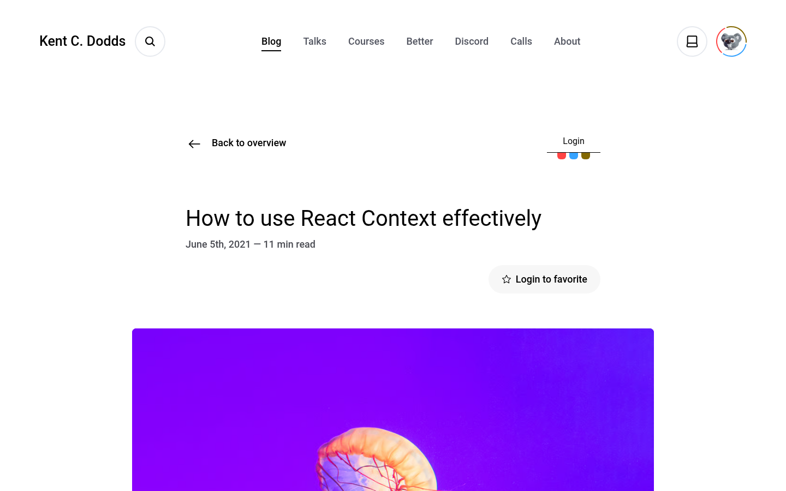 | 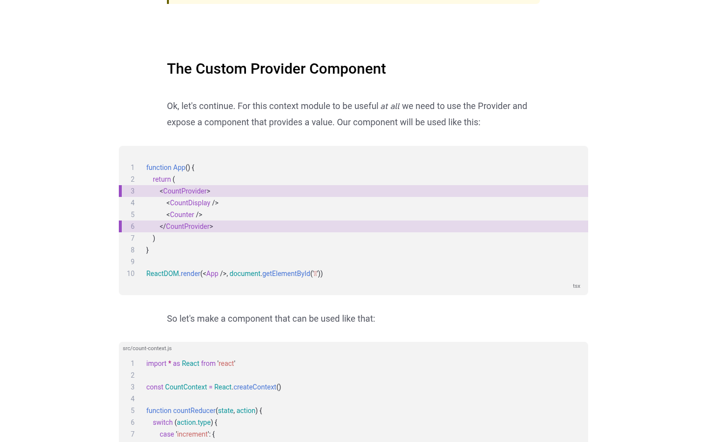 | 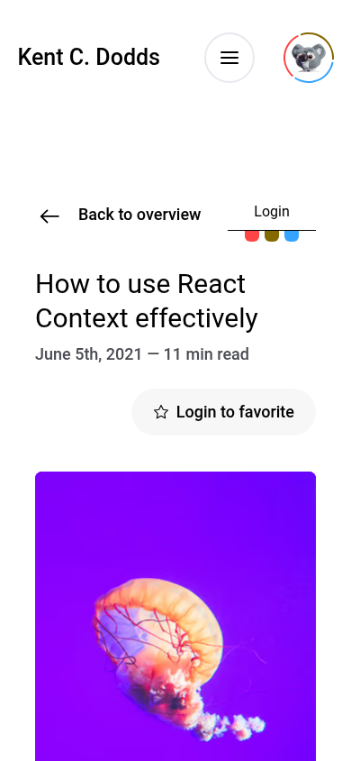 | 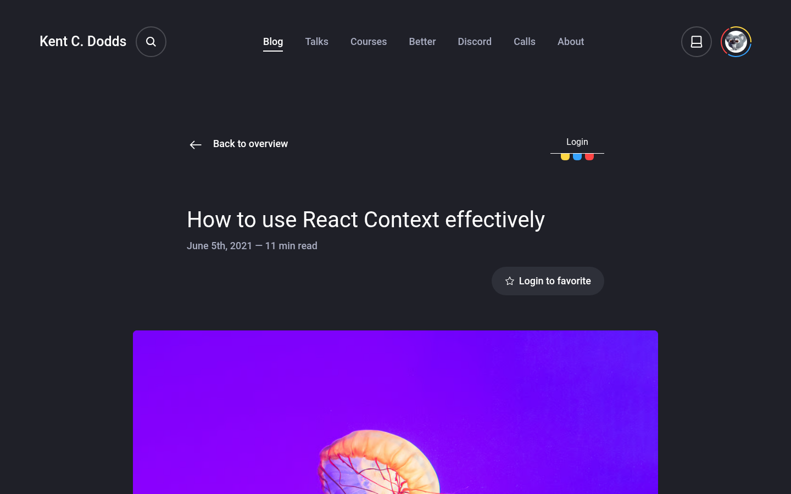 |
| Josh W. Comeau | 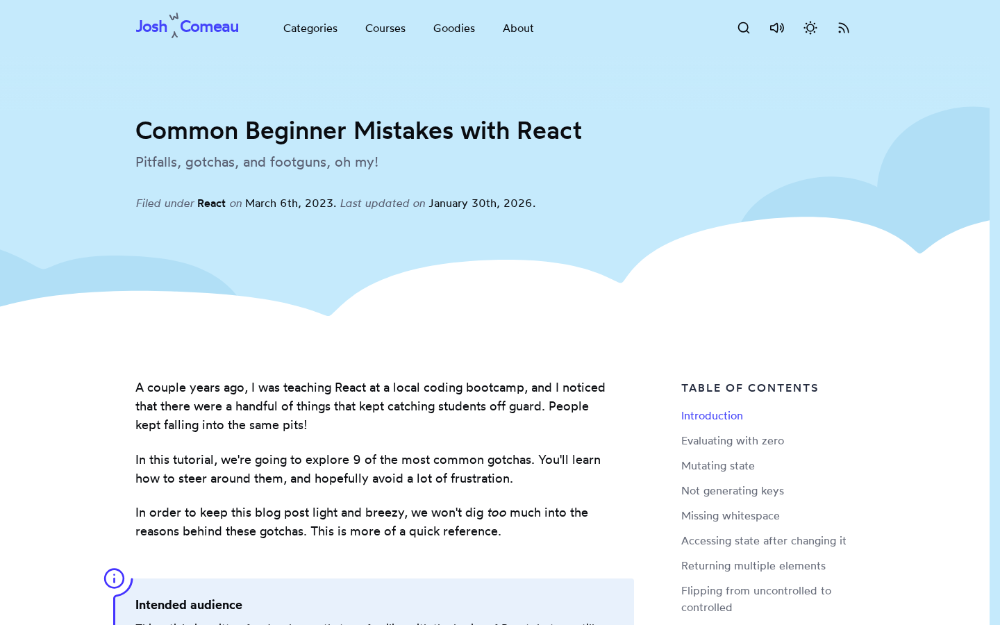 | 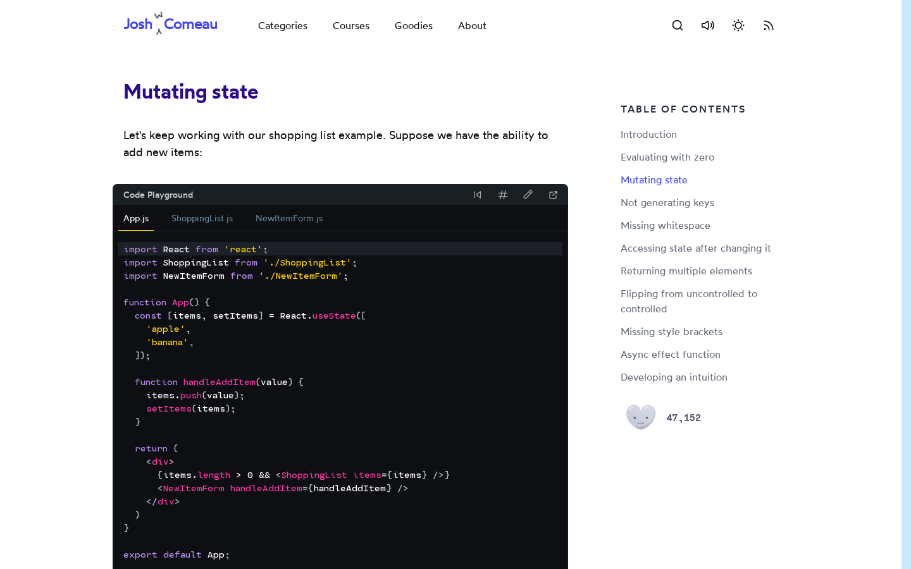 | 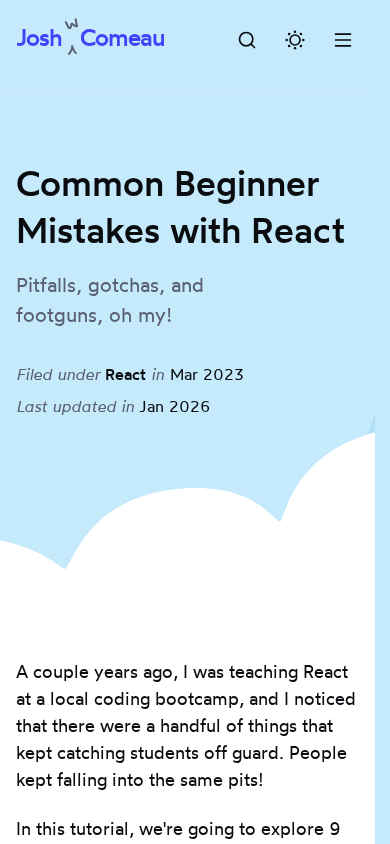 | 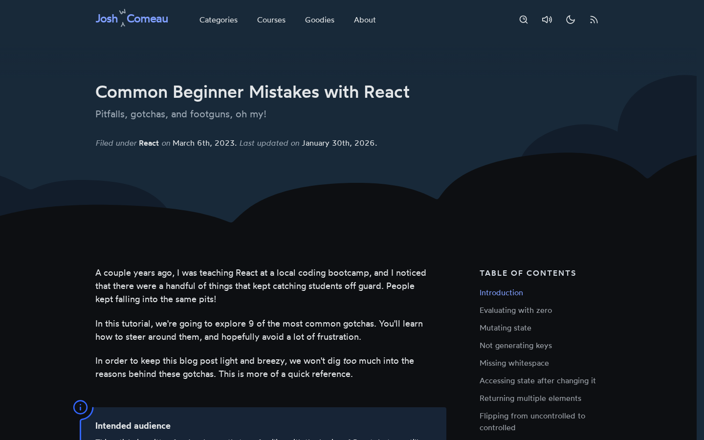 |
| Overreacted | 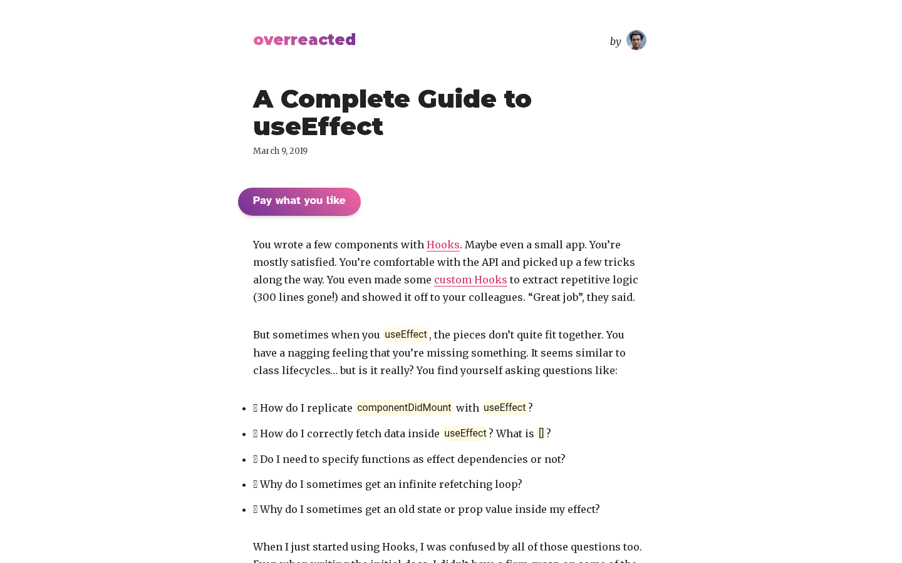 | 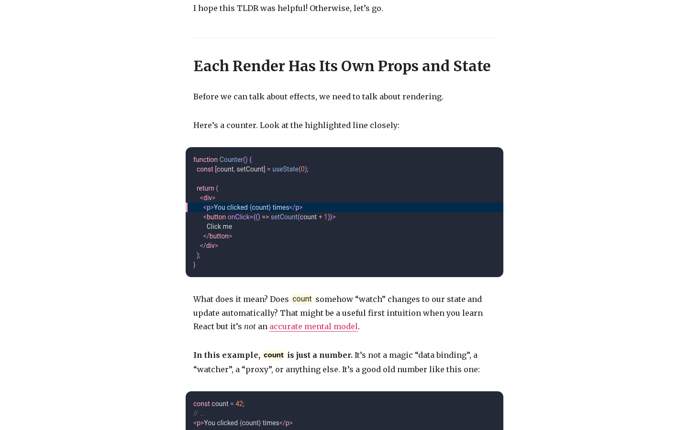 | 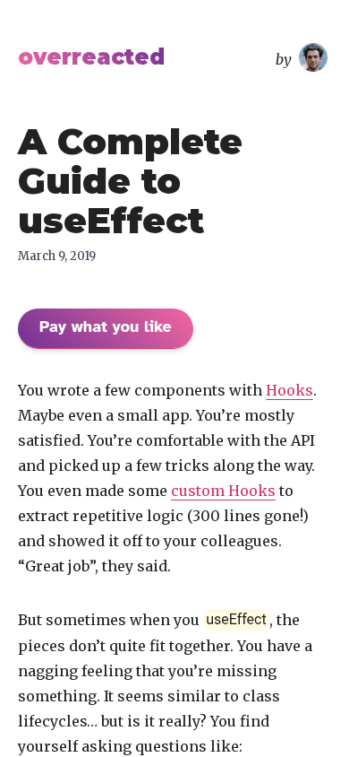 | 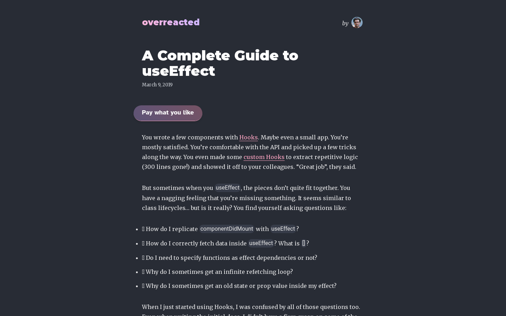 |
| Vercel | 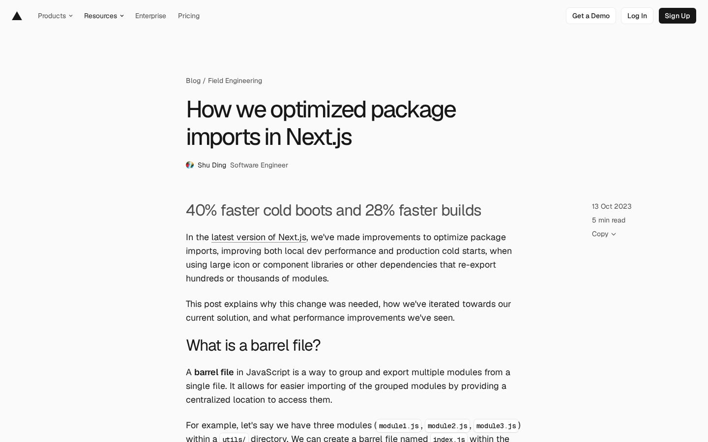 | 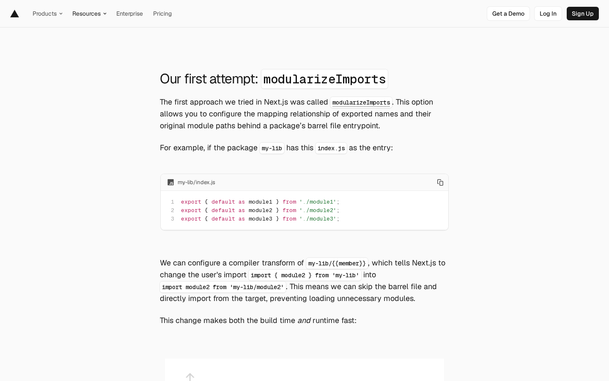 | 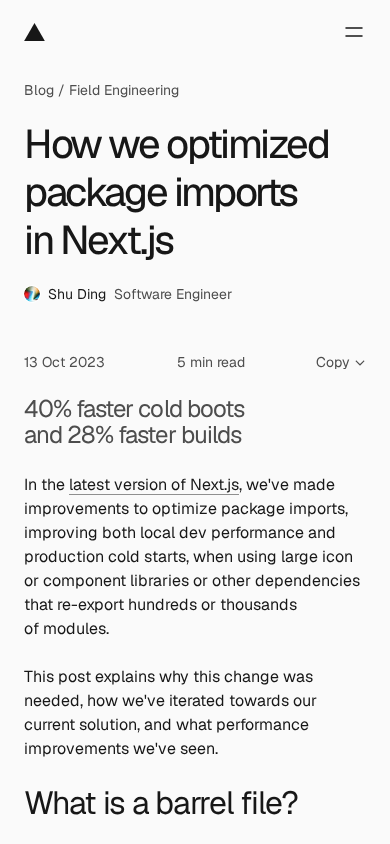 | 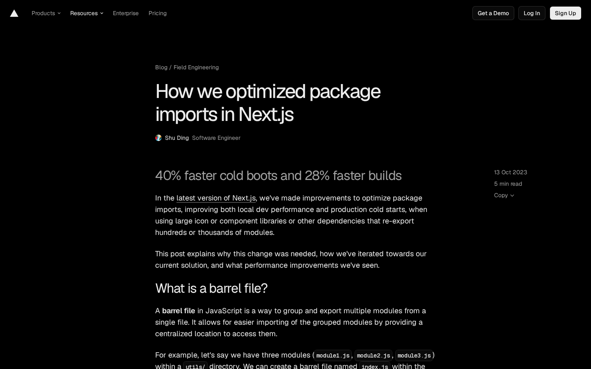 |
| Smashing | 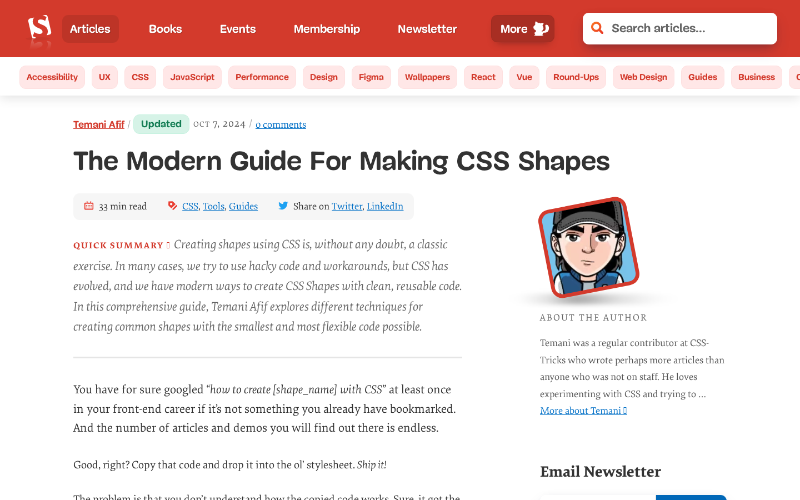 | 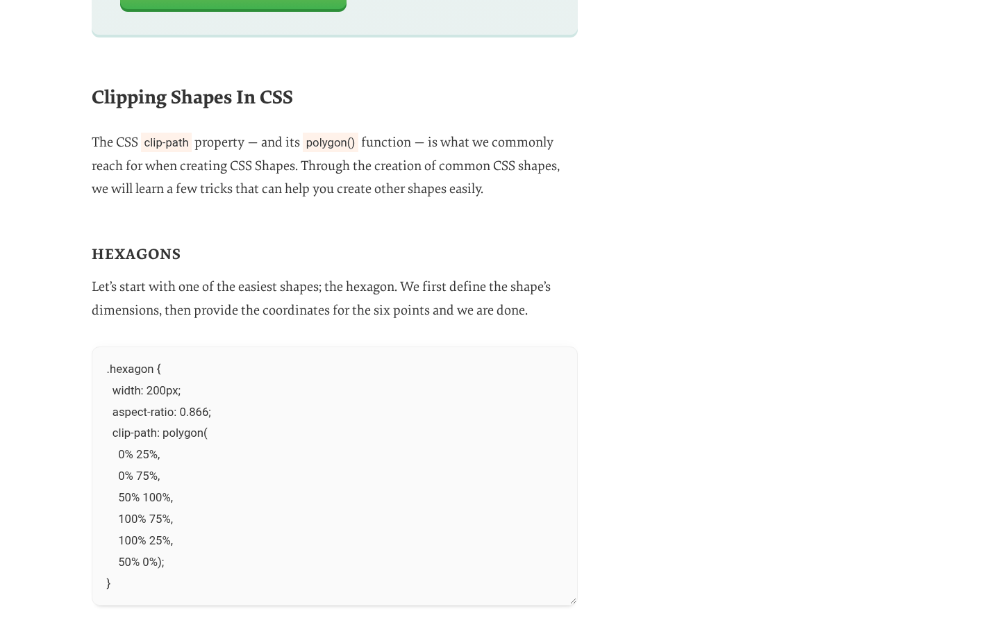 | 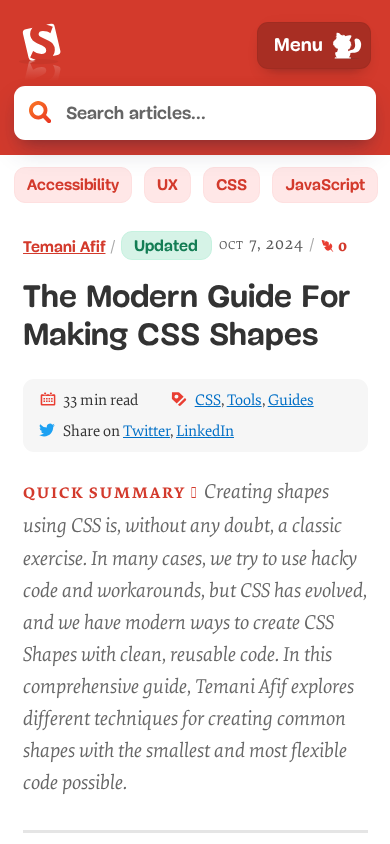 | — (no dark theme) |

How dark mode was applied and checked:

- Kent: swap the `light` class on `<html>` for `dark`. Body background became `rgb(31,32,40)` `[COMPUTED]`.
- Josh: `colorScheme: "dark"`. The site set `data-color-mode=dark` itself, and the html background became `rgb(24,41,57)` `[COMPUTED]`.
- Overreacted: `colorScheme: "dark"` only, which suggests a `prefers-color-scheme` media query. Body background became `rgb(40,44,53)` `[COMPUTED]`.
- Vercel: `colorScheme: "dark"` plus `localStorage.theme = "dark"`. `<html>` got the `dark-theme` class and the background became `rgb(0,0,0)` `[COMPUTED]`.

All PNGs are 41–211 KB.

---

## 1. Kent C. Dodds

### Typography
- Body `p`: system-ui, 18px / 31.5px (1.75), weight 400, colour `rgb(83,86,97)`, `margin-bottom: 32px` `[COMPUTED]`. Callout text is 19.2px / 33.6px `[COMPUTED]`.
- Title: an `<h2>` element, not `<h1>`. 40px / 50px, weight 400, black, 760px wide `[COMPUTED]`. On 390 it drops to 30px / 37.5px `[COMPUTED]`.
- h2: 30px / 40px, weight 500, `margin: 80px 0 40px` `[COMPUTED]`. Measured gap to the previous block is 112px above and 40px below (80px margin + 32px paragraph margin) `[COMPUTED]`. On 390: 25px, weight 400 `[COMPUTED]`.
- List items: 16px / 28px, 8px vertical margins `[COMPUTED]`. This is smaller than body text.
- Links in prose: black, weight 500 `[COMPUTED]`.

### Layout
- 12-column grid. Margin is `10vw`, max width 1280px, 24px gap. Prose sits in columns 3–10 at x=340, **760px** wide `[COMPUTED]`.
- CPL: canvas estimate 98; sampled line **95** `[COMPUTED]`. This is the widest measure of the five.
- 390: 312px column, side margins 39px, canvas estimate 40 CPL `[COMPUTED]`.

### Code, quote and image treatment
- `pre`: breaks out to columns 2–11, **956px** wide at x=242. Background `rgb(243,243,243)`, radius 8px, padding `32px 0`, monospace 14px / 24px, line numbers, highlighted lines with a purple left bar, a language label bottom-right, an optional filename label top-left `[COMPUTED]` (see body shot). On 390 it bleeds to the full viewport (390px, `margin: 0 -39px`, radius 0) `[COMPUTED]`.
- Inline code: 15.75px monospace with no background `[COMPUTED]`.
- Callouts (`<callout-danger>` and similar): `border-left: 4px solid` in the accent colour, radius `0 8px 8px 0`, padding `8px 16px`, tinted background `[COMPUTED]`.
- No blockquote in this post.
- Body images: full 760px column, radius 8px, no caption `[COMPUTED]`.
- Cover image: breaks out to 956px with radius 8px (title shot). In dark mode it is unchanged.

### Title block
- Order: "← Back to overview" link → title → `June 5th, 2021 — 11 min read` (18px, weight 500, `rgb(75,76,83)`, `margin-top: 8px`) → "Login to favorite" pill → cover image `[COMPUTED]`.
- No tags and no author byline in the title block.

### TOC and sidebar
- None. No sticky or fixed element with ≥3 hash links at any scroll position `[COMPUTED]`.

### Motion
- No `animationstart` or `transitionstart` events during load, heading hover, link hover or scroll `[COMPUTED]`.
- 9 `@keyframes` exist: `hero-image-reveal` (opacity 0 + scale 1.5 → 1), `hero-text-reveal` (translateY 25px →), and dialog in/out (translateY 10px + scale .98). None ran on this page `[SRC]`.
- `.underlined::after { transition: transform .25s }` for the nav underline. `:focus { transition: outline-offset .1s; outline-offset: 4px }` inside `no-preference` `[SRC]`.
- One IntersectionObserver with default options watching 1 element `[COMPUTED]`.
- `scroll-behavior: auto` `[COMPUTED]`.

### Reduced motion
- Hero reveals are opt-in through `@media (prefers-reduced-motion: no-preference)` (Tailwind `motion-safe:`). There is a `motion-reduce:duration-[0s]` utility. The dialog animation is forced to `none !important` under `reduce` `[SRC]`.

---

## 2. Josh W. Comeau

### Typography
- Fonts: **Wotfard** (text) and **Cartograph CF** (code) `[COMPUTED]`.
- Body `p`: 18px / 27px (1.5), colour `rgb(10,12,16)`, `margin-bottom: 22.5px` (1.25em) `[COMPUTED]`. The same size is used on 390.
- Title h1: 36px / 54px, weight 500, `text-wrap: balance` `[COMPUTED]` / `[SRC]`.
- Subtitle: 20px / 30px, `rgb(90,96,114)`, 4px under the h1 `[COMPUTED]`.
- h2: 32px / 48px, **weight 700**, coloured `rgb(44,11,142)` (deep indigo), `margin: 48px 0 32px` (`margin-top: 1.5em` `[SRC]`), `scroll-margin-top: 112px` (7rem) `[COMPUTED]`. Measured gaps: 71–112px above, 32px below `[COMPUTED]`.
- `h2, h3, h4, h5, h6, p { text-wrap: pretty }`, `h1 { text-wrap: balance }` `[SRC]`.
- `::selection` background is `rgb(255,236,143)` `[COMPUTED]`.

### Layout
- `<article>` is a 4-track grid: `162.5px 686px 350px 162.5px` at 1440 `[COMPUTED]`. Prose is **686px** at x=195. The TOC sits in the 350px track.
- CPL: canvas estimate 85; sampled line **82** `[COMPUTED]`.
- 390: 343px column, 16px side padding, about 42 CPL `[COMPUTED]`.
- The title block sits on a light-blue hero band with an illustrated cloud edge. In dark mode it is navy `rgb(24,41,57)` `[COMPUTED]`.

### Code, quote and image treatment
- Static code (`pre.shiki`): Cartograph 16px / 25.6px. It breaks out to **750px** at x=163 (32px each side beyond the prose) with 24px vertical padding on the wrapper `[COMPUTED]`.
- Code Playground (Sandpack): **718px** wide (`margin: 0 -16px`), background `rgb(13,15,18)` (dark even in light mode), radius 6px. It has a header bar with title, reset/format/open icons, and file tabs `[COMPUTED]`.
- Inline code: Cartograph 16.875px, padding `2px 6px`, background `rgb(232,241,252)`, radius 3px `[COMPUTED]`.
- Callout `<aside>`: 750px wide (`margin: 32px -32px 64px`), background `rgb(232,241,252)`, radius `0 4px 4px 0`, 3px left border, padding `24px 32px 24px 29px`, 16px / 24px text, and an info icon hanging in the left gutter `[COMPUTED]`.
- Images: radius 4px, shown at natural width and centred inside the column (e.g. 422px) `[COMPUTED]`.
- Body links: weight 500 with no `text-decoration`. The underline is `box-shadow: 0 1.5px 0 0 rgb(66,66,250)` and animates with `transition: box-shadow .2s` `[COMPUTED]`.
- No blockquote in this post.

### Title block
- h1 → subtitle → `Filed under React on March 6th, 2023. Last updated on January 30th, 2026.` (16px / 24px; italic "Filed under" / "on" labels, upright values) `[COMPUTED]`.
- No reading time, no author line, no cover image.

### TOC and sidebar
- **Sticky right TOC**: `position: sticky; top: 160px`, **250px** wide at x=981, 11 links `[COMPUTED]`. It is hidden (0×0) on 390 `[COMPUTED]`.
- Heading: "Table of Contents" as an `<h2>`, 16px, weight 500, `text-transform: uppercase`, `letter-spacing: 2px`, `rgb(38,45,64)`, 16px bottom margin `[COMPUTED]`.
- Links: 16px, weight 400, line spacing about 36px (from y positions).
  - Inactive: `rgb(38,45,64)`, **opacity 0.7** `[COMPUTED]`.
  - Active: primary `rgb(66,66,250)`, **opacity 1**, same weight, no background, no border `[COMPUTED]`.
  - Active state followed scroll: "Introduction" at top, "Mutating state" at the body shot, "Not generating keys" 2500px further down `[COMPUTED]`.
- `.c1kp06zm { transition: opacity .5s }`, and on `:hover, :focus` the rule is `transition: opacity` with no duration. Hover-in is instant and hover-out fades over 0.5s `[SRC]`. A `transitionstart` for `opacity 0.5s ease` fired on the TOC link during scroll `[COMPUTED]`.
- TOC item wrapper: `transition: opacity .4s, transform .7s cubic-bezier(.17,.67,.54,1)` `[SRC]`.
- No IntersectionObserver watched headings. The observers watched Sandpack containers (`rootMargin: 600px 0px`, threshold 0.2, 9 elements), Next.js link prefetch (`rootMargin: 200px`, 31 anchors), and single widgets `[COMPUTED]`. So the active-section tracking is probably scroll-position based `[INFERENCE]`.
- Below the TOC: a "like" heart button with a counter (body shot).

### Motion
- 72 `@keyframes` and 89 transition rules site-wide `[SRC]`. On load:
  - Header icons drop in with `dropIcon`: translateY(−8px)→0 + opacity 0→1, `cubic-bezier(.17,.67,.2,1)`, durations **600 / 700 / 800 / 900ms** with delays **100 / 200 / 300 / 400ms**, so a 100ms stagger `[COMPUTED]`.
  - Sandpack `fadeIn` 125ms and a spinner `[COMPUTED]`.
  - Article text never animates in `[COMPUTED]`.
- Heading anchor link (`a.aax5dne`, "Link to this heading", 32×32 in the left gutter, rest `opacity: 0`):
  - Hover-in: `opacity .25s, transform .25s cubic-bezier(.17,.67,.47,1)`.
  - Hover-out: `opacity .4s .25s, transform .4s cubic-bezier(.61,.55,.24,.97) .25s` (lingers 250ms) `[COMPUTED]`.
- No scroll-driven animations. All `animation-timeline` hits were `auto` shorthand resets `[SRC]`. `scroll-behavior: auto` `[COMPUTED]`.
- View Transitions are used for the search modal and navigation dropdown (`::view-transition-old(search-modal)` and others) `[SRC]`.

### Reduced motion
- 30 `prefers-reduced-motion` blocks `[SRC]`. Most decorative animations are wrapped in `no-preference`, for example `html { interpolate-size: allow-keywords }` and a spring `transform .5s`. Under `reduce`, some get explicit overrides: `animation: none; transition: none`, and the search-modal view transition becomes a plain 0.5s `fadeOut`. So reduced motion swaps movement for a fade rather than removing everything `[SRC]`.

---

## 3. Overreacted (Dan Abramov)

### Typography
- Fonts: **Merriweather** (serif body and h2) and **Montserrat 900** (title) `[COMPUTED]`.
- Body `p`: 16px / 28px (1.75), `rgb(34,34,34)` `[COMPUTED]`. The same on 390.
- Title h1: Montserrat 40px / 44px, **weight 900** `[COMPUTED]`.
- Date under the title: `March 9, 2019`, Merriweather 13px, `rgb(55,65,81)`, 8px top margin `[COMPUTED]`.
- h2: Merriweather 30px / 36px, weight 700, `margin-top: 8px` inside a flex column with `gap: 32px` `[COMPUTED]`. Effective gaps are **40px above, 32px below**. Each section opens with an `
` (1px `rgb(229,231,235)`, `opacity .6`, 16px above) `[COMPUTED]`. A `#` anchor appears on hover (`group-hover:opacity-70`) `[SRC]`.
- Lists: 16px / 28px with 12px between items `[COMPUTED]`.

### Layout
- Single centred column, **632px** at x=404, no sidebar `[COMPUTED]`.
- Paragraph spacing is the flex `gap`, 32px (148 of 148 sampled gaps) `[COMPUTED]`.
- CPL: canvas estimate 78; sampled line **76** `[COMPUTED]`.
- 390: 350px column, 20px side padding, about 43 CPL `[COMPUTED]`.

### Code, quote and image treatment
- `pre`: **664px** (`margin: 0 -16px`, so 16px past the text on each side), background `rgb(35,41,54)` (dark in both themes), radius 12px, padding 16px, monospace 14px / 20px `[COMPUTED]`.
  - Highlighted line: background `rgb(2,42,75)`, `border-left: 4px solid rgb(255,167,196)`, bleeding to the block edges `[COMPUTED]`.
  - On 390 the block goes full-bleed with radius 0 `[COMPUTED]`.
- Inline code: 16px monospace, background `rgba(255,229,100,.2)` (pale yellow), radius 10px, padding `2.4px 3.2px` `[COMPUTED]`.
- Blockquote: italic, `opacity .8`, `border-left: 3px solid` text colour, `padding-left: 16px`, and `margin-left: -16px` so the bar hangs into the gutter and the text stays aligned with body copy `[COMPUTED]` / `[SRC]` (class list).
- Images: natural size (e.g. 497px in a 632px column), radius 0, no caption `[COMPUTED]`.
- Links: pink `rgb(210,54,105)`, 1px underline, `text-underline-offset: 4px` `[COMPUTED]`.

### Title block
- Site wordmark plus "by [avatar]" → h1 → date → "Pay what you like" gradient pill → body.
- No reading time, no tags, no cover.

### TOC and sidebar
- None `[COMPUTED]`.

### Motion
- One keyframe (`pulse`). Transitions are Tailwind defaults: `150ms cubic-bezier(.4,0,.2,1)` `[SRC]`.
- No animation or transition events on load, hover or scroll `[COMPUTED]`.
- One IntersectionObserver: Next.js link prefetch, `rootMargin: 200px`, 13 links `[COMPUTED]`.

### Reduced motion
- A global kill switch: `@media (prefers-reduced-motion) { * { transition: none !important } }` `[SRC]`.

---

## 4. Vercel blog

### Typography
- Fonts: **Geist Sans** and **Geist Mono** (variable 100–900) `[COMPUTED]`. `html` sets `font-feature-settings: "rlig", "calt" 0, "ss11"` and `text-rendering: optimizeLegibility` `[SRC]`.
- Body `p`: 18px / 28px (1.56), `rgb(23,23,23)`, `text-wrap: pretty`. The paragraph gap is **24px** (13 of 13 samples) `[COMPUTED]`. On 390 the class switches to 16px / 24px (`text-copy-16 @lg:text-copy-18`) `[COMPUTED]`.
- Title h1: 48px / 56px, weight 450, **letter-spacing −2.88px** (−0.06em), `text-wrap: pretty` `[COMPUTED]`. On 390 it is 40px / 48px, −2.4px `[COMPUTED]`.
- Lead line ("40% faster cold boots…"): 32px / 35.2px, weight 400, grey `rgb(77,77,77)`, −1.28px tracking, 24px gap below `[COMPUTED]`.
- h2: 32px / 35.2px, weight 400, −1.28px, `text-wrap: balance`, `scroll-margin-top: 90px`. Gaps are 24px above and below, or 64px when a code block precedes the heading `[COMPUTED]`.
- h3: 28px / 30.8px, weight 400, with `padding-top: 40px` (`pt-10`) `[COMPUTED]`.
- Headings are big and light (weight 400–450) with tight tracking, so hierarchy comes from size, not weight `[INFERENCE]`.

### Layout
- Prose is **684px** at x=378 `[COMPUTED]`.
- CPL: canvas estimate 84; sampled line **78** `[COMPUTED]`.
- Right rail: `<aside>` at x=1204, 212px wide, `position: static` (it scrolls away). It holds `13 Oct 2023`, `5 min read` and a "Copy" dropdown, 14px / 20px, `rgb(77,77,77)` `[COMPUTED]`.
- Page background is `rgb(250,250,250)`, not pure white `[COMPUTED]`.

### Code, quote and image treatment
- Code card: 680px. Header bar is 40px high, background `rgb(250,250,250)`, radius `8px 8px 0 0`, with a file icon, the filename at 13px and a copy button. The body is a white `pre` with a `border-x`/`border-b` in `gray-400` and radius `0 0 8px 8px`. Code is Geist Mono 13px / 20px with line numbers `[COMPUTED]` (body shot).
- Inline code: Geist Mono 14px, white background, 1px border, radius 6px, padding `4px 5px`. It reads as a small chip `[COMPUTED]` (screenshot).
- Heading anchor: "Copy link to heading" button floated into the left gutter (`-ml-8`, 32px), `opacity: 0` at rest, `transition: .1s cubic-bezier(.4,0,.2,1)` `[COMPUTED]`.
- Images: embedded tweet media and author avatars only. No figure or figcaption in this post `[COMPUTED]`.
- Links: text colour, 1px underline in `rgb(143,143,143)`, `text-underline-offset: 4px` `[COMPUTED]`.

### Title block
- Breadcrumb `Blog / Field Engineering` (14px, grey) → h1 → author row (16px avatar + `Shu Ding` + role in grey, 14px) → lead → body. Date and reading time sit in the right rail, not under the title `[COMPUTED]`.

### TOC and sidebar
- No TOC on this post. The right rail holds metadata only and is not sticky `[COMPUTED]`.
- At the bottom there is an "Explore" `<aside>` with related links `[COMPUTED]`.

### Motion
- 59 `@keyframes` site-wide: `fade-slide-in` (translateY −8px → 0), `slideUpFadeIn` (translateY 8px → 0), `soft-fade-in` (opacity .3 → 1), `show`/`hide` (translate3d with variables), and more `[SRC]`.
- On this page the only load events were a loading spinner and a 150ms colour transition on a `
` `[COMPUTED]`.
- Arbitrary utilities seen: `fadein-inplace 400ms ease-out` with **200 / 350 / 500ms** delays (a 150ms stagger) `[SRC]`. They are not used in the article body `[COMPUTED]`.
- Duration scale in use: 75, 100, 150, 160, 180, 200, 220, 225, 250, 280, 300, 350, 400, 450, 500, 550, 700, 1000, 1200, 1400, 2500ms `[SRC]`.
- IntersectionObservers: link prefetch (`rootMargin: 200px`, 40 anchors) and analytics (threshold 0.1, 30 anchors) `[COMPUTED]`. None watched headings.

### Reduced motion
- Tailwind `motion-safe:` / `motion-reduce:` variants throughout. `#marketing-header { transition: none }` under `reduce`. Some components treat `reduce` the same as `max-width: 601px` and disable their animation on small screens too `[SRC]`.

---

## 5. Smashing Magazine

### Typography
- Fonts: **Elena** (serif body and headings) and **Mija 700** (title), with `font-feature-settings: "onum"` (old-style numerals) on `body`. Dates use small caps (`"smcp", "c2sc"`, `letter-spacing: 1px`) `[SRC]` / `[COMPUTED]`.
- Body `p`: **fluid size**, 20.41px / 33.49px (1.64) at 1440 (140 of 141 paragraphs) and 18.92px / 30.42px at 1024. `margin-bottom: 28.57px` `[COMPUTED]`.
- Title h1: Mija 49.04px / 58.85px, weight 700, spanning 1176px (wider than the body column) `[COMPUTED]`.
- "Quick summary" lead: italic, 20.4px, grey, with a small-caps red label `[COMPUTED]` (screenshot).
- h2: 27.6px / 41.4px, weight 700, `margin: 41.4px 0 27.6px` `[COMPUTED]`. Measured gaps: 60–70px above, 28px below `[COMPUTED]`.
- h3: 21.6px / 32.4px, weight 700, `letter-spacing: 1px`. Some h3s are uppercase (e.g. "HEXAGONS" in the body shot) `[COMPUTED]`.

### Layout
- 12+ track grid. Body column is **700px** at x=132. A 336px right column holds the author card and newsletter; it is not sticky `[COMPUTED]`.
- CPL: canvas estimate 86; sampled line **75** `[COMPUTED]`.
- Only a fixed `back-to-top` button is fixed or sticky `[COMPUTED]`.

### Code, quote and image treatment
- `pre`: 700px (no breakout), background `rgb(250,250,250)`, `1px solid rgb(238,238,238)`, radius 11px, padding 16px, a three-layer soft box-shadow, Fira Code 16.75px / 30.88px `[COMPUTED]`. The code line height is very loose (body shot).
- Inline code: Fira Code 16.75px, background `rgb(255,242,234)` (peach), padding `0 4.56px`, radius 0 `[COMPUTED]`.
- Blockquote: italic, 21.43px / 35.36px, `border-left: 11px solid rgb(230,228,225)`, radius 11px, padding `21.4px 39.3px`, colour `rgb(66,66,66)` `[COMPUTED]`.
- Figures: `.break-out` at 798px (98px past the column on the right). `figcaption` is italic, 19.39px / 29.08px, `rgb(102,102,102)`, start-aligned, padding-right 38.8px `[COMPUTED]`.

### Title block
- Author (red link) / green "Updated" pill / small-caps date / comment count → h1 → grey rounded meta box (`rgb(246,246,246)`, radius 11px): `33 min read`, tags `CSS, Tools, Guides`, share links → quick summary → `
` → body `[COMPUTED]` / `[SRC]`.

### TOC and sidebar
- **Inline TOC** in the content flow: an h3 "Table of Contents" at y=1307 after the summary and a sponsor panel. It is not sticky `[COMPUTED]`.
- `:target { scroll-margin-top: 2rem }` `[SRC]`.

### Motion
- **`:target` heading flash**: `h2:target, h3:target, … { border-radius: 11px; animation: fadeOut-headings .4s ease forwards }`. The keyframe fades a highlight background plus a `box-shadow: 0 0 0 7px` halo from `--block-separator-color` to `--article-target-color` `[SRC]`. TOC-link targets also turn red `[SRC]`.
- 89 transitions site-wide, mostly `.1s–.3s ease-in-out` / `ease-out` on buttons, cart and author-image tilt `[SRC]`.
- On load, only newsletter input and image `transform .2s ease-out` transitions fired. No article animations, no IntersectionObservers `[COMPUTED]`.

### Reduced motion
- **No** `prefers-reduced-motion` rules anywhere `[SRC]`.

---

## Cross-site patterns

| | Kent | Josh | Overreacted | Vercel | Smashing |
|---|---|---|---|---|---|
| Body font | system-ui sans | Wotfard sans | Merriweather serif | Geist sans | Elena serif |
| Body size / line-height (1440) | 18 / 31.5px (1.75) | 18 / 27px (1.5) | 16 / 28px (1.75) | 18 / 28px (1.56) | 20.4 / 33.5px (1.64, fluid) |
| Body size (390) | 18px | 18px | 16px | 16px | 18px |
| Prose column | 760px | 686px | 632px | 684px | 700px |
| Sampled CPL | 95 | 82 | 76 | 78 | 75 |
| Paragraph gap | 32px | 22.5px (1.25em) | 32px | 24px | 28.6px |
| h1 | 40/50, w400 | 36/54, w500 | 40/44, w900 | 48/56, w450, −0.06em | 49/59, w700 |
| h2 | 30/40, w500 | 32/48, w700, coloured | 30/36, w700 + hr | 32/35, w400, −0.04em | 27.6/41, w700 |
| h2 gap above / below | 112 / 40 | 71–112 / 32 | 40 / 32 | 24–64 / 24 | 60–70 / 28 |
| Code breakout | +98px each side (956) | +32px (750) / playground +16px | +16px (664) | none (680) | none (700); figures +98 right |
| Code bg / radius | light grey / 8px | dark playground, 6px | dark navy / 12px | white card, header bar / 8px | off-white + shadow / 11px |
| TOC | none | **sticky right, top 160, 250px** | none | none (static meta rail) | inline, top of article |
| TOC active state | — | colour → primary, opacity .7 → 1, `opacity .5s` | — | — | `:target` heading flash .4s |
| Heading anchor | — | gutter icon, .25s in / .4s out | `#` on hover | gutter button, .1s | red on `:target` |
| Article motion | none | none in body; header stagger 100ms | none | none in body | `:target` flash .4s |
| Reduced motion | `motion-safe` opt-in | 30 rules; reduce → fade | global `* {transition:none}` | `motion-safe/-reduce` | none |

Patterns:

- **Measure**: four of five sites land at 75–82 sampled characters per line in a 632–700px column. Kent is the outlier at 760px and 95 CPL `[COMPUTED]`.
- **Body size**: 18px is the norm at desktop. 16px with a 1.75 line-height also works for a serif (Overreacted). Line-height is 1.5–1.75 `[COMPUTED]`.
- **Heading rhythm**: space above h2 is 1.25–3.5× the space below. Every site keeps the heading closer to its own section than to the previous one `[COMPUTED]` / `[INFERENCE]`.
- **Breakouts**: code and media are usually 16–98px wider than the prose column on desktop and full-bleed at radius 0 on mobile (Kent, Overreacted) `[COMPUTED]`.
- **TOC**: only one of five has a persistent TOC. It is quiet: a small uppercase tracked label, 16px links, inactive at 70% opacity, active in the accent colour, no rail, no background pill, no bold `[COMPUTED]`.
- **Motion**: none of the five animates article text in on load or on scroll. There are no scroll-driven animations, no reveal-on-scroll IntersectionObservers, and `scroll-behavior` is `auto` everywhere `[COMPUTED]`. Motion only appears on interaction feedback: anchor-link reveal, link underline, TOC state, `:target` flash. Durations are 100–500ms `[COMPUTED]` / `[SRC]`.

## Takeaways for this site

All bullets are `[INFERENCE]` drawn from the measurements above.

1. **Measure:** cap the prose column at about **680px** (≈ `42.5rem`). Source Sans 3 is narrower than Wotfard or Geist, so at 18–19px that gives roughly 80–85 CPL; `max-width: 66ch`–`70ch` is a safer cap if you want 70–75 CPL. Do not go to Kent's 760px.
2. **Body size:** 18px (1.125rem) at desktop, line-height **1.65–1.75** (about 30–31px). Keep 17–18px on mobile; Josh and Kent do not shrink below 18px. The paragraph gap should be about one line-height or a bit less (24–32px).
3. **Heading rhythm:** h2 at about 30–32px. Use roughly **64–80px above and 24–32px below** (Kent and Josh band). Add `scroll-margin-top` equal to the sticky header height plus about 24px (Josh uses 112px, Vercel 90px). Use `text-wrap: balance` on h1/h2 and `pretty` on p (Josh, Vercel).
4. **Code blocks:** break out 16–32px past the prose on each side at desktop (Overreacted / Josh), full-bleed with radius 0 at mobile. Radius 8–12px. A filename header bar plus a copy button follows the Vercel pattern if needed.
5. **TOC style (Josh pattern):** sticky, `top` = header + about 32px, **about 250px** wide. Small uppercase label (14–16px, `letter-spacing: 2px`, weight 500). 15–16px links at **opacity .7**. The active link is the accent colour at opacity 1, with no bold weight change (that avoids reflow). Hide it below the breakpoint where the 3-column grid no longer fits.
6. **Motion worth borrowing:**
   - TOC link: **instant on hover-in, `opacity 500ms` on hover-out**. Use the same for active-state changes, so the highlight glides between items without a sliding indicator.
   - Heading anchor icon in the left gutter: `opacity`+`transform` **250ms** in, **400ms out with a 250ms delay** (Josh).
   - Link underline as `box-shadow` / `text-decoration-color` transition, **200ms**.
   - `:target` heading highlight after a TOC jump: a **400ms** fade of a background or halo (Smashing). This gives feedback when the TOC is clicked.
   - If the title block gets an entrance, keep it to small chrome elements: **8px translate + opacity, 600–900ms, 100ms stagger, `cubic-bezier(.17,.67,.2,1)`** (Josh header icons). Do not animate body text.
7. **Reduced motion:** gate all of the above behind `prefers-reduced-motion: no-preference` (Kent / Vercel pattern). Under `reduce`, keep colour and opacity changes and drop transforms (Josh pattern) rather than killing every transition globally.
8. **Avoid:**
   - Article-wide fade-in or reveal-on-scroll; no reference site does it.
   - Scroll-driven animations on prose.
   - `scroll-behavior: smooth` without a reduced-motion guard.
   - Bold-on-active TOC links (layout shift).
   - Measures over about 85 CPL.
   - Smashing's 30px code line-height (too loose).
   - Kent's title as `<h2>`; keep a real `<h1>`.

## Proposed design (round 1)

All of this is `[INFERENCE]`: design choices for this site, drawn from the takeaways above and the issue's scope. Colours stay on the existing tokens; #748 owns the palette.

### Current state (before)

- The title is 28–32px, smaller than the body's first `#` heading (prose `h1` at 2.25em, weight 800), so the first section heading reads as the page title.
- At 768px the sidebar, body and fixed TOC share one row: the body column is about 200px wide and the TOC covers the title. At 1024px the TOC overlaps the location trail.
- On mobile the full article list comes before the article, so the first screen has no article text.
- Date is `4/13/2025` (locale format), no reading time. No cover image. No motion.

### Layout

| Width | Sidebar (article list) | Body | TOC |
|---|---|---|---|
| < 1024 (390, 768) | After the article, full width | One column, 40rem cap, 20–32px side padding | Collapsible "In this article" panel above the body |
| 1024–1279 | Sticky left column (existing width token) | 40rem column centred in the rest | Collapsible panel above the body |
| ≥ 1280 | Sticky left column | 40rem column; right padding reserves the TOC gap (existing token) | Fixed right rail (existing position and well) |

- DOM order is unchanged (sidebar, then article); only the visual order flips below 1024px.
- Body measure **40rem (640px)**. At 18px Source Sans 3 a full line samples at about 78 characters, inside the 75–82 band of four of the five reference sites.

### Title block

Order, top to bottom: location trail → category eyebrow (14px, semibold, uppercase, 0.12em tracking, muted) → title → description → meta row → cover.

- Title: 34px (390) / 44px (≥ 640) / 52px (≥ 1280), weight 600, line-height 1.12, tight tracking, `text-wrap: balance`. It is now the largest text on the page.
- Description: 18–20px, muted, `text-wrap: pretty`.
- Meta row: `April 13th, 2025 · 5 min read` (14px, medium, muted; same date format as the home page cards), tags on the right from 640px. Reading time is words ÷ 230, rounded up.
- Cover: the article's `socialImage` at the body width, 1200:630, 12px radius, hairline border. Omitted when the article has none.

### Body rhythm

- Body 17px (mobile) / 18px, line-height 1.75 (Kent's ratio).
- Markdown `#` is a section heading here: 28–30px, weight 600, 64px above / 16px below. `##` 23px (48 / 12), `###` 19px (40 / 8). The gap above is about 3–4× the gap below, inside the reference band.
- Quotes: 3px left border, upright text, no curly quote marks. Obsidian callouts keep their colours, get a 4px left border, 12px radius and more padding.
- Code: inline code gets a muted chip with a hairline border; blocks get a 12px radius, hairline border, 14px text. No breakout yet (no article has a code block today).
- Images: centred, 12px radius, hairline border. Links: 1.5px underline, 3px offset.

### TOC

- Same well and position as today from 1280px. Label 14px semibold.
- A 1px rail runs down the list. Headings the reader has reached keep the existing active colour. The **current** heading (the last one reached) gets a 2px bar on the rail in the active colour and `aria-current="location"`.
- Colour and bar changes ease over 300ms, so the highlight glides between items. No weight change, so no reflow.

### Motion

The research found no reference site that reveals article text on scroll. The issue asks for it, so it is kept small and safe:

- **Page enter:** the title block, cover and body column fade in and rise 12px over 700ms, `cubic-bezier(.17,.67,.2,1)` (Josh's header easing). It replays when another article is opened. The sidebar and the fixed TOC do not animate.
- **Scroll reveal:** body blocks (paragraphs, headings, quotes, lists, code, images) that start **below the fold** wait at opacity 0, 16px lower, and fade/rise in over 700ms as soon as any part of them enters the viewport. Blocks in view on load are never hidden. Only `opacity` and `translate` change, so nothing shifts layout.
- **TOC:** 300ms colour and rail-bar transitions, as above.

Guarantees:

- `prefers-reduced-motion: reduce`: no page enter, no reveals, no TOC transitions. The hidden state only exists inside `motion-safe:` rules, so it cannot apply even if a script misbehaves.
- Heading deep links (`/articles/x#heading`): page enter and reveals are off for that visit, so the target heading and its content are visible as soon as the page scrolls there.
- In-page jumps (TOC or any `#` link, `hashchange`): every held block shows at once, without a fade.
- No IntersectionObserver, or JS not run yet: nothing is ever held back. The script only hides blocks that are already off screen, after the first layout.
- Print: all blocks print fully visible.
- The rule logic (`resolveArticleMotion`, `resolveRevealStep`) is a pure module with unit tests; Playwright covers reduced motion and deep links.

### Open questions for round 1

1. The only cover in `content/` today is the generic site card. Keep showing `socialImage` as a cover, or drop the cover until articles have their own images?
2. Article list after the article on mobile, or a collapsible list at the top?
3. Reveal strength: 16px / 700ms now. Subtler (8px, 500ms) or as is?
4. The article title is an `<h2>` (the sidebar holds the page `<h1>`). Make the article title the `<h1>`?
